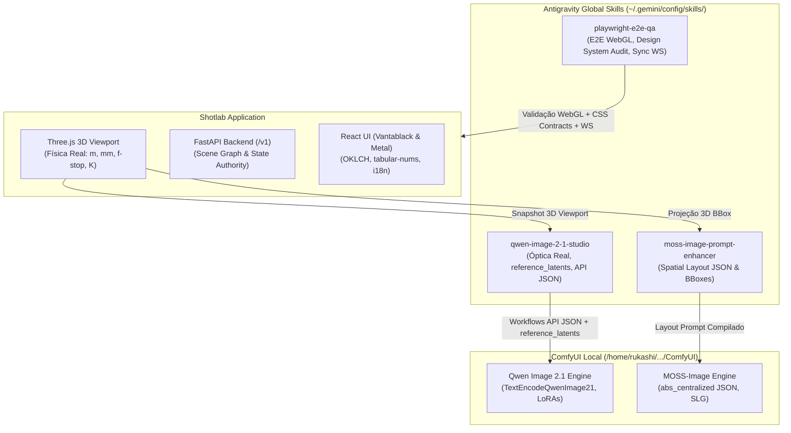

# Modelos de IA e Skills Globais — Shotlab

Este documento descreve as **Skills Globais** instaladas no Antigravity (`~/.gemini/config/skills/`) para operação da arquitetura **Dual-Engine de Geração de Imagem** (Qwen Image 2.1 & MOSS-Image) e **Garantia de Qualidade Full-Stack (E2E & WebGL)** no ecossistema **Shotlab**.

---

## 1. Visão Geral da Arquitetura de Skills

Para manter a separação estrita de responsabilidades definida em [`AGENTS.md`](file:///home/rukashi/Documentos/GitHub/Shotlab/AGENTS.md) e [`DESIGN.md`](file:///home/rukashi/Documentos/GitHub/Shotlab/DESIGN.md), qualquer agente atuando no repositório dispõe de três skills especializadas instaladas no ambiente global:



---

## 2. Skill 1: `moss-image-prompt-enhancer`

- **Localização Global**: `~/.gemini/config/skills/moss-image-prompt-enhancer/`
- **Origem**: Repositório MOSS-Image local (`/home/rukashi/Documentos/ComfyUI_windows_portable/MOSS-Image`).

### Propósito & Capacidades
Expande briefs criativos e dados de cena em descrições de imagem com **Layout Espacial Preciso** baseado em caixas delimitadoras (*bounding boxes*). 

A skill inclui o utilitário Python `compile_prompt.py`, que valida e converte drafts legíveis de layout com coordenadas em pixels absolutos (`xyxy`) para a sintaxe matemática esperada pelo MOSS-Image:
- Formato de saída: Linha única de JSON minificado contendo `items` com coordenadas centralizadas `abs_centralized` no formato `[y_min, x_min, y_max, x_max]` relativas ao centro da tela `(0, 0)`.

### Uso no Shotlab
No Shotlab, objetos, sujeitos e modificadores de luz posicionados no Viewport 3D Three.js são projetados para o plano de visualização da câmera virtual como Bounding Boxes 2D. O agente utiliza esta skill para montar o draft e compilar o layout final:

```bash
# Compilação de draft de layout para prompt MOSS-Image
python3 ~/.gemini/config/skills/moss-image-prompt-enhancer/scripts/compile_prompt.py \
  draft_scene_layout.json --output moss_prompt.txt
```

---

## 3. Skill 2: `qwen-image-2-1-studio`

- **Localização Global**: `~/.gemini/config/skills/qwen-image-2-1-studio/`
- **Arquivo de Instruções**: `~/.gemini/config/skills/qwen-image-2-1-studio/SKILL.md`

### Propósito & Capacidades
Ensina aos agentes como gerar prompts de estúdio hiper-realistas baseados em **física óptica real** e como construir e disparar workflows ComfyUI em **API format JSON** para o modelo **Qwen Image 2.1**.

### Diretrizes Centrais da Skill:
1. **Física e Parâmetros Fotográficos Reais**:
   - Lentes e distância focal em milímetros (`24mm`, `35mm`, `50mm`, `85mm`, `135mm`).
   - Abertura de diafragma real em f-stops (`f/1.4`, `f/2.0`, `f/2.8`, `f/8.0`) para controle autêntico de profundidade de campo e bokeh.
   - Iluminação calibrada em Kelvin (`2700K` a `3200K` tungstênio/golden hour, `5600K` daylight estúdio, `6500K` overcast) com esquemas de 3 pontos (Key, Fill, Rim).
2. **Nós ComfyUI Especializados**:
   - `TextEncodeQwenImage21`: Suporte a múltiplos de 32 em resolução, autogrow de 1 a 16 referências visuais, tratamento inteligente de transparência RGBA (alpha sobre branco para vision tower e 4 canais no VAE) e saída de condicionamento com `reference_latents`.
   - `TextEncodeQwenImageEditPlus`: Edição multimodal com até 3 imagens e template conversacional LLaMA.
   - `QwenImage21Cache`: Otimização de KV cache (`device: cpu` para liberar VRAM em GPUs com menos de 24GB sem perda de latência).
3. **Mecanismo `reference_latents` (3D → Render)**:
   - A captura do Viewport Three.js é codificada pelo VAE do Qwen 2.1 e injetada no condicionamento, guiando o transformer de difusão a reproduzir a exata pose, composição e distribuição de iluminação do modelo 3D.
4. **LoRAs Locais Disponíveis**:
   - `Qwen-Image-Lightning-4steps-V1.0.safetensors`: Aceleração de inferência para 4 passos (sampler `euler`, scheduler `simple`, CFG `1.0`).
   - `Qwen-Edit-Relight.safetensors`: Re-iluminação dinâmica preservando geometria do modelo.
   - `Qwen-Edit-2509-Multiple-angles.safetensors`: Modificação de ângulo de câmera e órbita.
5. **Formato ComfyUI API JSON Estrito**:
   - Workflows gerados estritamente no formato de grafo de execução consumido por `POST /prompt` (dicionário `{ "node_id": { "class_type": "...", "inputs": { ... } } }`), nunca o formato de interface gráfica (`nodes`/`links`).

---

## 4. Skill 3: `playwright-e2e-qa`

- **Localização Global**: `~/.gemini/config/skills/playwright-e2e-qa/`
- **Arquivo de Instruções**: `~/.gemini/config/skills/playwright-e2e-qa/SKILL.md`

### Propósito & Capacidades
Habilita testes End-to-End e QA Visual Full-Stack automatizados cobrindo a pilha completa do Shotlab (FastAPI + Vite React + Three.js).

### Diretrizes Centrais da Skill:
1. **Suporte a WebGL / Three.js Headless**:
   - Inicialização do Chromium com aceleração por software via SwiftShader:
     ```python
     args = ["--enable-webgl", "--ignore-gpu-blocklist", "--use-gl=angle", "--use-angle=swiftshader"]
     ```
   - Testado e homologado para WebGL 2.0 (`OpenGL ES 3.0 Chromium, SwiftShader driver`).
2. **Orquestração Coordenada de Servidores**:
   - Inicialização automática e verificação de saúde do Backend FastAPI (`:8000`) e Frontend Vite (`:5173`).
3. **Asserções de Canvas e Zero Erros de Console**:
   - Monitoramento contínuo de exceções JavaScript e garantia de que nenhum erro de perda de contexto WebGL ocorra durante a navegação 3D.
4. **Auditoria Estrita do Design System (`DESIGN.md` & `AGENTS.md`)**:
   - Proibição de cores "AI Slop" genéricas (`#3b82f6`, `#6366f1`).
   - Verificação de fontes monoespaçadas com `tabular-nums` em todas as telemetrias e grandezas físicas (`mm`, `f/`, `m`, `°`, `K`).
   - Validação de suporte a temas Dark (`Vantablack & Metal`) e Light (`Daylight Studio & Silver`) em OKLCH, além da troca de idioma i18n (`pt-BR`, `en-US`, `es-ES`).
5. **Validação de Sincronização API-First em Tempo Real**:
   - Teste de chamadas REST (`PATCH /v1/scenes/...`) e verificação de que o DOM e o Viewport refletem as mudanças instantaneamente via WebSocket sem reload de página.

---

## 5. Como Invocar as Skills

Qualquer agente operando no repositório Shotlab pode consultar e seguir diretamente as regras detalhadas de cada skill lendo seus respectivos arquivos `SKILL.md`:
- [moss-image-prompt-enhancer](file:///home/rukashi/.gemini/config/skills/moss-image-prompt-enhancer/SKILL.md)
- [qwen-image-2-1-studio](file:///home/rukashi/.gemini/config/skills/qwen-image-2-1-studio/SKILL.md)
- [playwright-e2e-qa](file:///home/rukashi/.gemini/config/skills/playwright-e2e-qa/SKILL.md)

Essas skills garantem uniformidade técnica, precisão fotográfica e robustez nos testes de todo o ciclo de vida do Shotlab.
