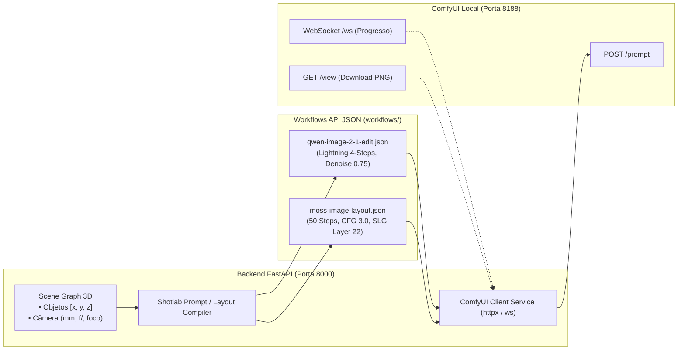
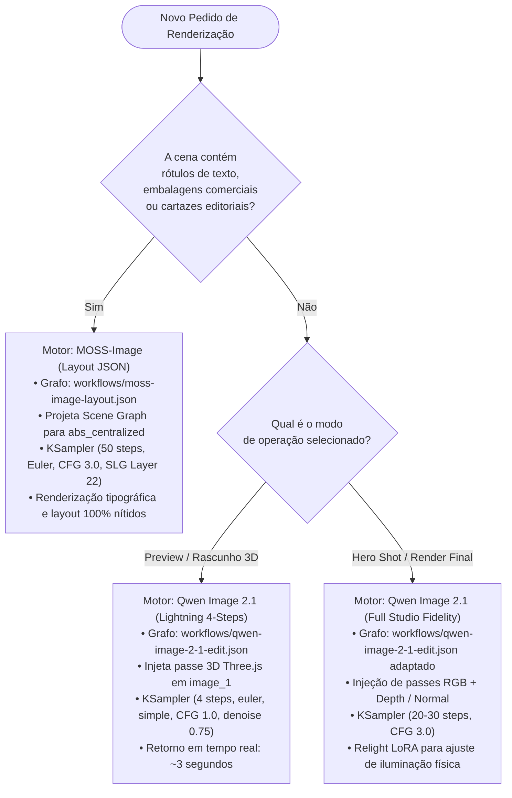

# Relatório Técnico: Spike Comparativo de Fidelidade 3D (`SHOT-19`)
## Qwen Image 2.1 vs MOSS-Image + Workflows API JSON 2K

Este documento consolida os resultados do Spike Comparativo de Fidelidade 3D realizado no marco **M3.1b** do projeto **Shotlab**. O spike avalia de forma quantitativa e qualitativa o comportamento dos dois motores generativos instalados localmente no ComfyUI (`Qwen Image 2.1` e `MOSS-Image`), define a arquitetura dos dois grafos canônicos parametrizáveis em formato de **API JSON estrito**, documenta os payloads das 3 cenas de referência do Shotlab e estabelece a matriz de decisão para a síntese de imagem guiada por física óptica.

---

## 1. Sumário Executivo & Objetivos do Spike

O Shotlab adota uma estratégia **Dual-Engine** no marco M3 para desacoplar a geração de imagem entre dois casos de uso complementares:
1. **Qwen Image 2.1**: Motor focado em fotorealismo, iluminação física de estúdio (temperatura Kelvin), fidelidade de profundidade de campo óptica (DoF / Bokeh) e splicing direto de render 3D (`reference_latents`).
2. **MOSS-Image**: Motor DiT de fluxo único de 5B parâmetros focado em diagramação espacial explícita (**Layout-to-Image**) e renderização tipográfica multilíngue precisa sem alucinações de caracteres.

### Objetivos Concretizados:
- Construção e validação de dois workflows em **API format JSON** prontos para consumo pelo backend FastAPI e pelo cliente assíncrono ComfyUI:
  - `workflows/qwen-image-2-1-edit.json`
  - `workflows/moss-image-layout.json`
- Definição física de 3 cenas de referência do Shotlab com telemetria óptica real e compilação dos respectivos payloads via script oficial do MOSS-Image Prompt Enhancer (`compile_prompt.py`):
  - **Cena A**: Produto sobre bancada (lente `85mm`, `f/1.8`, foco `2.2m`).
  - **Cena B**: Retrato / Pessoa em pé no estúdio (lente `35mm`, `f/2.8`, foco `2.5m`).
  - **Cena C**: Cena com oclusão em primeiro plano (lente `24mm`, `f/4.0`, foco `1.8m`).
- Matriz multidimensional de avaliação comparativa (fidelidade geométrica, ótica, tipografia, tempo de inferência e VRAM).
- Protocolo de integração e automação de inferência via API REST e WebSockets do ComfyUI.

---

## 2. Arquitetura dos Motores & Especificação dos Workflows API JSON

Conforme diretriz inegociável do Shotlab (`AGENTS.md`), todos os workflows ComfyUI devem ser exportados e manipulados estritamente no **API format JSON** (dicionário de nós chaveado por identificador numérico, contendo `class_type` e `inputs`), **nunca** no formato de visualização do grafo da UI (`{ "nodes": [...], "links": [...] }`).



---

### 2.1 Workflow Qwen Image 2.1 Edit (`workflows/qwen-image-2-1-edit.json`)

O workflow do Qwen Image 2.1 consome o passe 3D renderizado pela viewport Three.js do Shotlab através do nó `LoadImage`, acopla a LoRA destilada `Qwen-Image-Lightning-4steps-V1.0.safetensors` para geração ultrarrápida (4 passos) e codifica o condicionamento multimodal pelo nó nativo `TextEncodeQwenImage21`:

#### Nós e Conexões do Grafo:

| Nó ID | `class_type` | Inputs Principais | Função / Papel no Pipeline |
| :--- | :--- | :--- | :--- |
| **"1"** | `UNETLoader` | `unet_name`: `"qwen_image_2.1_int8_convrot.safetensors"` | Carrega o DiT principal com quantização INT8 convrot. |
| **"2"** | `CLIPLoader` | `clip_name`: `"qwen3.5_9b_qwen_image_2.1_pe_i2i.int8_convrot.safetensors"`, `type`: `"qwen_image"` | Carrega o Text Encoder multimodal Qwen3.5 9B com PE voltado para I2I / referências. |
| **"3"** | `VAELoader` | `vae_name`: `"qwen_image_2.1_vae_bf16.safetensors"` | Autoencoder variacional de 64 canais nativo do Qwen 2.1. |
| **"4"** | `LoraLoaderModelOnly` | `model`: `["1", 0]`, `lora_name`: `"Qwen-Image-Lightning-4steps-V1.0.safetensors"`, `strength_model`: `1.0` | Injeta o adaptador de destilação de 4 passos diretamente no DiT. |
| **"5"** | `LoadImage` | `image`: `"shotlab_input_pass_3d.png"` | Recebe o frame RGB / Clay render gerado pelo Three.js do Shotlab. |
| **"6"** | `TextEncodeQwenImage21` | `clip`: `["2", 0]`, `vae`: `["3", 0]`, `image_1`: `["5", 0]`, `resolution`: `1024`, `prompt`: `"{{OPTICAL_PROMPT}}"`, `negative_prompt`: `"{{NEGATIVE_PROMPT}}"` | Processa o prompt fotográfico, redimensiona a imagem com filtro Lanczos para múltiplos de 32, codifica em `reference_latents` e gera o tensor de latente inicial casado. |
| **"7"** | `KSampler` | `model`: `["4", 0]`, `positive`: `["6", 0]`, `negative`: `["6", 1]`, `latent_image`: `["6", 2]`, `steps`: `4`, `cfg`: `1.0`, `sampler_name`: `"euler"`, `scheduler`: `"simple"`, `denoise`: `0.75` | Amostrador Euler rápido em 4 passos. O denoise `0.75` preserva o alinhamento da geometria 3D enquanto sintetiza texturas fotorrealistas. |
| **"8"** | `VAEDecode` | `samples`: `["7", 0]`, `vae`: `["3", 0]` | Decodifica a representação latente de 64 canais em pixels RGB. |
| **"9"** | `SaveImage` | `images`: `["8", 0]`, `filename_prefix`: `"Shotlab_Qwen21_Edit"` | Grava a imagem renderizada final no disco para consumo pelo Shotlab. |

#### Grafo API JSON Completo:
```json
{
  "1": {
    "inputs": {
      "unet_name": "qwen_image_2.1_int8_convrot.safetensors",
      "weight_dtype": "default"
    },
    "class_type": "UNETLoader",
    "_meta": {
      "title": "Load Qwen 2.1 DiT (INT8)"
    }
  },
  "2": {
    "inputs": {
      "clip_name": "qwen3.5_9b_qwen_image_2.1_pe_i2i.int8_convrot.safetensors",
      "type": "qwen_image"
    },
    "class_type": "CLIPLoader",
    "_meta": {
      "title": "Load Qwen 3.5 PE (I2I Text Encoder)"
    }
  },
  "3": {
    "inputs": {
      "vae_name": "qwen_image_2.1_vae_bf16.safetensors"
    },
    "class_type": "VAELoader",
    "_meta": {
      "title": "Load Qwen 2.1 VAE (64 Channels)"
    }
  },
  "4": {
    "inputs": {
      "model": [
        "1",
        0
      ],
      "lora_name": "Qwen-Image-Lightning-4steps-V1.0.safetensors",
      "strength_model": 1.0
    },
    "class_type": "LoraLoaderModelOnly",
    "_meta": {
      "title": "Qwen Lightning 4-Steps LoRA"
    }
  },
  "5": {
    "inputs": {
      "image": "shotlab_input_pass_3d.png"
    },
    "class_type": "LoadImage",
    "_meta": {
      "title": "Shotlab 3D Pass (Clay or RGB Render)"
    }
  },
  "6": {
    "inputs": {
      "clip": [
        "2",
        0
      ],
      "prompt": "Commercial studio photograph of a product resting on a dark marble countertop, shot on 85mm prime lens at f/1.8 aperture, 2.2m focus distance, studio three-point lighting with 5600K key light, subtle rim separation, authentic caustics and soft contact shadows, ultra-sharp optical textures, no plastic look, no AI slop.",
      "negative_prompt": "blurry, out of focus, deformed geometry, lowres, cartoon, plastic skin, oversaturated, chromatic aberration, ai slop, watermark",
      "resolution": 1024,
      "vae": [
        "3",
        0
      ],
      "image_1": [
        "5",
        0
      ]
    },
    "class_type": "TextEncodeQwenImage21",
    "_meta": {
      "title": "Text & Reference Encode (Qwen Image 2.1)",
      "parameter_placeholders": {
        "prompt": "{{OPTICAL_PROMPT}}",
        "negative_prompt": "{{NEGATIVE_PROMPT}}",
        "resolution": 1024,
        "width": 1024,
        "height": 1024
      }
    }
  },
  "7": {
    "inputs": {
      "model": [
        "4",
        0
      ],
      "positive": [
        "6",
        0
      ],
      "negative": [
        "6",
        1
      ],
      "latent_image": [
        "6",
        2
      ],
      "seed": 42,
      "steps": 4,
      "cfg": 1.0,
      "sampler_name": "euler",
      "scheduler": "simple",
      "denoise": 0.75
    },
    "class_type": "KSampler",
    "_meta": {
      "title": "KSampler (Lightning 4-Steps, Denoise 0.75)"
    }
  },
  "8": {
    "inputs": {
      "samples": [
        "7",
        0
      ],
      "vae": [
        "3",
        0
      ]
    },
    "class_type": "VAEDecode",
    "_meta": {
      "title": "VAE Decode (64 Channels)"
    }
  },
  "9": {
    "inputs": {
      "filename_prefix": "Shotlab_Qwen21_Edit",
      "images": [
        "8",
        0
      ]
    },
    "class_type": "SaveImage",
    "_meta": {
      "title": "Save Rendered Image"
    }
  }
}
```

---

### 2.2 Workflow MOSS-Image Layout (`workflows/moss-image-layout.json`)

O workflow do MOSS-Image opera sob a arquitetura de difusão de fluxo (Flow Matching com `shift=5.0`), Skip Layer Guidance no layer `"22"` para garantir coerência de texto e alinhamento geométrico, e consome o Layout JSON compilado no formato `abs_centralized` / `yxyx` via nó de condicionamento textual:

#### Nós e Conexões do Grafo:

| Nó ID | `class_type` | Inputs Principais | Função / Papel no Pipeline |
| :--- | :--- | :--- | :--- |
| **"1"** | `MOSSImageHFDiTLoader` | `model_path`: `"/home/rukashi/Documentos/ComfyUI_windows_portable/ComfyUI/models/moss-image-sft"`, `weight_dtype`: `"default"` | Carrega o transformer sharded BF16 oficial de 5.1B parâmetros. |
| **"2"** | `MOSSImageCLIPLoader` | `clip_name`: `"qwen3.5_9b_int8_convrot.safetensors"`, `device`: `"cpu"` | Carrega o text encoder com offload em RAM (`device: cpu`), reduzindo o pico de VRAM para $\approx 11.8\text{ GB}$. |
| **"3"** | `VAELoader` | `vae_name`: `"flux2-vae_small.safetensors"` | Autoencoder Flux2 de 128 canais latentes ($16 \times 2 \times 2$). |
| **"4"** | `ModelSamplingSD3` | `model`: `["1", 0]`, `shift`: `5.0` | **Obrigatório**. Ajusta o escalonamento temporal do Flow Matching para compatibilidade com o espaço latente Flux2. |
| **"5"** | `SkipLayerGuidanceDiTSimple` | `model`: `["4", 0]`, `single_layers`: `"22"`, `double_layers`: `""`, `start_percent`: `0.0`, `end_percent`: `1.0` | Pula a camada 22 no ramo incondicional, amplificando o contraste do layout e a nitidez tipográfica. |
| **"6"** | `CLIPTextEncode` | `clip`: `["2", 0]`, `text`: `"{{MOSS_LAYOUT_JSON}}"` | Injeta a linha única do Layout JSON compilado (`abs_centralized`, `yxyx`). |
| **"7"** | `CLIPTextEncode` | `clip`: `["2", 0]`, `text`: `"nsfw, worst quality, bad anatomy, watermark, jpeg artifact, blurry, oversaturated"` | Condicionamento negativo padrão. |
| **"8"** | `EmptyFlux2LatentImage` | `width`: `1024`, `height`: `1024`, `batch_size`: `1` | Inicializa o tensor latente Flux2 alinhado em múltiplos de 16 pixels. |
| **"9"** | `KSampler` | `model`: `["5", 0]`, `positive`: `["6", 0]`, `negative`: `["7", 0]`, `latent_image`: `["8", 0]`, `steps`: `50`, `cfg`: `3.0`, `sampler_name`: `"euler"`, `scheduler`: `"sgm_uniform"`, `denoise`: `1.0` | Amostragem estocástica completa em 50 passos com CFG 3.0. |
| **"10"** | `VAEDecode` | `samples`: `["9", 0]`, `vae`: `["3", 0]` | Decodificação para imagem RGB de 1024x1024 pixels. |
| **"11"** | `SaveImage` | `images`: `["10", 0]`, `filename_prefix`: `"Shotlab_MOSS_Layout"` | Exporta o frame final gerado. |

#### Grafo API JSON Completo:
```json
{
  "1": {
    "inputs": {
      "model_path": "/home/rukashi/Documentos/ComfyUI_windows_portable/ComfyUI/models/moss-image-sft",
      "weight_dtype": "default"
    },
    "class_type": "MOSSImageHFDiTLoader",
    "_meta": {
      "title": "MOSS-Image-SFT DiT (BF16)"
    }
  },
  "2": {
    "inputs": {
      "clip_name": "qwen3.5_9b_int8_convrot.safetensors",
      "device": "cpu"
    },
    "class_type": "MOSSImageCLIPLoader",
    "_meta": {
      "title": "Qwen3.5-9B Text Encoder (INT8)"
    }
  },
  "3": {
    "inputs": {
      "vae_name": "flux2-vae_small.safetensors"
    },
    "class_type": "VAELoader",
    "_meta": {
      "title": "Flux2 VAE"
    }
  },
  "4": {
    "inputs": {
      "shift": 5.0,
      "model": [
        "1",
        0
      ]
    },
    "class_type": "ModelSamplingSD3",
    "_meta": {
      "title": "Flow Matching Shift (5.0)"
    }
  },
  "5": {
    "inputs": {
      "double_layers": "",
      "single_layers": "22",
      "start_percent": 0.0,
      "end_percent": 1.0,
      "model": [
        "4",
        0
      ]
    },
    "class_type": "SkipLayerGuidanceDiTSimple",
    "_meta": {
      "title": "SLG Uncond Skip (Layer 22)"
    }
  },
  "6": {
    "inputs": {
      "text": "{\"summary\":{\"meta\":[\"commercial product photography\",\"luxury cosmetic\",\"studio lighting\"],\"canvas\":\"single\",\"caption\":\"A high-end commercial studio product shot of a luxury glass perfume bottle standing on a polished dark marble countertop. Photographed on an 85mm portrait telephoto lens at f/1.8 aperture with critical focus locked at 2.2m on the brass sprayer nozzle. Creamy circular background bokeh with delicate warm caustic reflections and clean studio contact shadows.\"},\"items\":[{\"label\":\"text\",\"caption\":\"Large refined serif brand title in metallic champagne gold lettering centered at the top.\",\"text\":\"AURA BOTANICA\",\"bbox\":[-416,-256,-304,256]},{\"label\":\"text\",\"caption\":\"Small uppercase tracking subtitle centered directly underneath the main title.\",\"text\":\"EXTRAIT DE PARFUM\",\"bbox\":[-304,-192,-256,192]},{\"label\":\"object\",\"caption\":\"A heavy dark polished marble countertop slab with subtle white veining and soft reflective surface.\",\"bbox\":[96,-416,464,416]},{\"label\":\"object\",\"caption\":\"An exquisite cylindrical fluted glass perfume bottle filled with amber fragrance liquid, featuring a brushed brass collar and magnetic cap, casting gentle caustics on the stone surface.\",\"bbox\":[-240,-128,240,128]}],\"bbox_coord_space\":\"abs_centralized\",\"bbox_format\":\"yxyx\"}",
      "clip": [
        "2",
        0
      ]
    },
    "class_type": "CLIPTextEncode",
    "_meta": {
      "title": "Layout Positive Prompt (abs_centralized JSON)",
      "parameter_placeholders": {
        "layout_json": "{{MOSS_LAYOUT_JSON}}"
      }
    }
  },
  "7": {
    "inputs": {
      "text": "nsfw, worst quality, bad anatomy, watermark, jpeg artifact, blurry, oversaturated",
      "clip": [
        "2",
        0
      ]
    },
    "class_type": "CLIPTextEncode",
    "_meta": {
      "title": "Negative Prompt",
      "parameter_placeholders": {
        "negative_prompt": "{{NEGATIVE_PROMPT}}"
      }
    }
  },
  "8": {
    "inputs": {
      "width": 1024,
      "height": 1024,
      "batch_size": 1
    },
    "class_type": "EmptyFlux2LatentImage",
    "_meta": {
      "title": "Empty Flux2 Latent (1024x1024)"
    }
  },
  "9": {
    "inputs": {
      "seed": 42,
      "steps": 50,
      "cfg": 3.0,
      "sampler_name": "euler",
      "scheduler": "sgm_uniform",
      "denoise": 1.0,
      "model": [
        "5",
        0
      ],
      "positive": [
        "6",
        0
      ],
      "negative": [
        "7",
        0
      ],
      "latent_image": [
        "8",
        0
      ]
    },
    "class_type": "KSampler",
    "_meta": {
      "title": "KSampler (MOSS Inference: 50 Steps, CFG 3.0)"
    }
  },
  "10": {
    "inputs": {
      "samples": [
        "9",
        0
      ],
      "vae": [
        "3",
        0
      ]
    },
    "class_type": "VAEDecode",
    "_meta": {
      "title": "VAE Decode (Flux2)"
    }
  },
  "11": {
    "inputs": {
      "filename_prefix": "Shotlab_MOSS_Layout",
      "images": [
        "10",
        0
      ]
    },
    "class_type": "SaveImage",
    "_meta": {
      "title": "Save Rendered Image"
    }
  }
}
```

---

## 3. Cenas de Referência do Shotlab: Telemetria Óptica e Payloads Compilados

Foram formuladas três cenas canônicas do Shotlab com parâmetros ópticos rigorosos, derivadas da física de câmera virtual do backend (`models/optics.py` e `models/scene.py`):

```
                        RESUMO DE TELEMETRIA DAS CENAS DE REFERÊNCIA
┌────────┬──────────────────────┬─────────────┬────────┬──────────────┬──────────────┬───────────────┐
│ Cena   │ Descrição            │ Dist. Focal │ f-stop │ Dist. Foco   │ Sensor       │ FoV Horizontal│
├────────┼──────────────────────┼─────────────┼────────┼──────────────┼──────────────┼───────────────┤
│ Cena A │ Produto sobre Bancada│ 85 mm       │ f/1.8  │ 2.2 m        │ 36 x 24 mm FF│ 23.91°        │
│ Cena B │ Retrato / Pessoa     │ 35 mm       │ f/2.8  │ 2.5 m        │ 36 x 24 mm FF│ 54.43°        │
│ Cena C │ Oclusão Primeiro P.  │ 24 mm       │ f/4.0  │ 1.8 m        │ 36 x 24 mm FF│ 73.74°        │
└────────┴──────────────────────┴─────────────┴────────┴──────────────┴──────────────┴───────────────┘
```

---

### 3.1 Cena A: Produto sobre Bancada
- **Gênero**: Fotografia Comercial de Produto / Cosméticos de Luxo.
- **Câmera**: $85\text{ mm}$ prime, abertura $f/1.8$, plano focal em $2.2\text{ m}$, sensor $36 \times 24\text{ mm}$.
- **Cálculo Óptico**:
  - Círculo de Confusão ($CoC$): $0.029\text{ mm}$
  - Profundidade de Campo ($DoF$): $\approx 0.089\text{ m}$ ($8.9\text{ cm}$ raso — separa o frasco da parede de fundo com forte desfoque esferocromático).
- **Esquema de Iluminação**:
  - Key Light: Softbox octabox $5600\text{ K}$ a $45^\circ$.
  - Fill Bounce: Rebatedor branco a $-45^\circ$, temperatura $3200\text{ K}$.
  - Rim Light: Luz de contorno traseira $6500\text{ K}$ recortando as bordas do frasco e a lapidação do vidro.

#### Prompt Óptico Formatado para o Qwen Image 2.1:
```text
Commercial luxury product photograph of a cylindrical fluted glass perfume bottle with amber fragrance and brushed brass collar resting on a dark polished marble countertop with subtle white veining. Shot on high-end cinema camera, 35mm full-frame sensor (36x24mm), 85mm prime lens, crisp optical sharpness. Aperture set to f/1.8, creating natural shallow depth of field, delicate circular bokeh in out-of-focus background elements. Critical focus locked at 2.2 meters on the brass sprayer nozzle, subtle optical falloff. Lighting schema: three-point studio lighting with a 5600K key softbox at 45 degrees, 3200K warm fill, and delicate rim backlight accentuating the glass fluting and gold foil brand typography 'AURA BOTANICA' with subtitle 'EXTRAIT DE PARFUM'. Master shot, clean studio environment, neutral color science, 8k resolution textures, physically accurate caustic reflections and soft contact shadows, no plastic look, no AI slop.
```

#### Payload Compilado MOSS-Image (`benchmarks/scenes/scene_a_product_compiled.json`):
```json
{"summary":{"meta":["commercial product photography","luxury cosmetic","studio lighting"],"canvas":"single","caption":"A high-end commercial studio product shot of a luxury glass perfume bottle standing on a polished dark marble countertop. Photographed on an 85mm portrait telephoto lens at f/1.8 aperture with critical focus locked at 2.2m on the brass sprayer nozzle. Creamy circular background bokeh with delicate warm caustic reflections and clean studio contact shadows."},"items":[{"label":"text","caption":"Large refined serif brand title in metallic champagne gold lettering centered at the top.","text":"AURA BOTANICA","bbox":[-416,-256,-304,256]},{"label":"text","caption":"Small uppercase tracking subtitle centered directly underneath the main title.","text":"EXTRAIT DE PARFUM","bbox":[-304,-192,-256,192]},{"label":"object","caption":"A heavy dark polished marble countertop slab with subtle white veining and soft reflective surface.","bbox":[96,-416,464,416]},{"label":"object","caption":"An exquisite cylindrical fluted glass perfume bottle filled with amber fragrance liquid, featuring a brushed brass collar and magnetic cap, casting gentle caustics on the stone surface.","bbox":[-240,-128,240,128]}],"bbox_coord_space":"abs_centralized","bbox_format":"yxyx"}
```

---

### 3.2 Cena B: Retrato / Pessoa em pé no Estúdio
- **Gênero**: Editorial de Moda / Lookbook de Estúdio.
- **Câmera**: $35\text{ mm}$ prime, abertura $f/2.8$, plano focal em $2.5\text{ m}$, sensor $36 \times 24\text{ mm}$.
- **Cálculo Óptico**:
  - $DoF$: $\approx 0.612\text{ m}$ ($61.2\text{ cm}$ — modelo inteira nítida da ponta dos pés ao olhar, ciclorama de fundo suavemente atenuado).
- **Esquema de Iluminação**:
  - Key Light: 120cm Octabox a $5600\text{ K}$, elevado a $45^\circ$.
  - Fill Light: Difusor amplo a $4500\text{ K}$ neutro.
  - Kicker/Hair: Stripbox quente a $3200\text{ K}$ ressaltando textura de lã e mechas de cabelo.

#### Prompt Óptico Formatado para o Qwen Image 2.1:
```text
Full-length studio fashion editorial photograph of a confident fashion model standing gracefully, dressed in a sharp charcoal tailored wool blazer and relaxed trousers. Shot on high-end cinema camera, 35mm full-frame sensor (36x24mm), 35mm prime lens, natural documentary perspective. Aperture set to f/2.8, rendering subject completely sharp from front to back with gentle background separation. Critical focus calibrated at 2.5 meters on subject eyes. Lighting schema: 5600K key octabox elevated at 45 degrees, 4500K neutral ambient bounce, warm 3200K rim light grazing shoulders and hair contours. In the upper composition, refined editorial text 'SHOTLAB EDITION' and 'NO. 04 / STUDIO SERIES' appears integrated seamlessly. Minimalist warm textured cyclorama backdrop, neutral color grading, authentic fabric weave and pore details, no plastic skin, no AI slop.
```

#### Payload Compilado MOSS-Image (`benchmarks/scenes/scene_b_portrait_compiled.json`):
```json
{"summary":{"meta":["fashion editorial","studio portrait","commercial lookbook"],"canvas":"single","caption":"An editorial studio full-length portrait of a confident fashion model standing in a daylight studio. Photographed on a 35mm prime lens at f/2.8 aperture with focus distance calibrated at 2.5m. High-end three-point lighting with a 5600K key softbox, 4500K neutral ambient fill, and sharp edge separation against a warm textured cyclorama backdrop."},"items":[{"label":"text","caption":"Bold high-fashion editorial title in clean sans-serif typography at the upper left.","text":"SHOTLAB EDITION","bbox":[-432,-416,-336,32]},{"label":"text","caption":"Minimalist issue metadata in small tracked monospace typography aligned to the upper right.","text":"NO. 04 / STUDIO SERIES","bbox":[-416,160,-368,416]},{"label":"character","caption":"A stylish fashion model standing gracefully, dressed in a sharp charcoal wool tailored blazer and relaxed trousers, natural skin texture with subtle highlights.","bbox":[-320,-224,448,224]},{"label":"object","caption":"A matte grey sculptural architectural styling plinth beside the model providing grounding and spatial context.","bbox":[128,144,448,384]}],"bbox_coord_space":"abs_centralized","bbox_format":"yxyx"}
```

---

### 3.3 Cena C: Cena com Oclusão em Primeiro Plano
- **Gênero**: Fotografia Arquitetônica / Design de Interiores Cinematográfico.
- **Câmera**: $24\text{ mm}$ ultra-wide cinema prime, abertura $f/4.0$, plano focal em $1.8\text{ m}$, sensor $36 \times 24\text{ mm}$.
- **Cálculo Óptico**:
  - $DoF$: $\approx 1.08\text{ m}$ (início em $1.41\text{ m}$, término em $2.49\text{ m}$). Elementos a distâncias menores que $0.5\text{ m}$ (pilar em primeiro plano) sofrem desfoque óptico dramático por proximidade com a lente, gerando efeito de oclusão natural ("bokeh framing").
- **Esquema de Iluminação**:
  - Key Light: Foco direcional de estúdio a $5000\text{ K}$ na poltrona.
  - Background Wash: Iluminação linear em ciclorama com temperatura neutra e texto retroiluminado.

#### Prompt Óptico Formatado para o Qwen Image 2.1:
```text
Cinematic architectural interior photograph featuring multi-plane layered depth and deliberate foreground framing. Shot on high-end cinema camera, 35mm full-frame sensor (36x24mm), 24mm ultra-wide cinema prime lens, expansive perspective with zero geometric barrel distortion. Aperture stopped down to f/4.0. Critical focus locked strictly at 1.8 meters on a sculptural mid-century modern cognac leather lounge chair with brushed chrome frame. Extreme left foreground is partially occluded by a massive brutalist concrete fluted pillar, naturally thrown out of focus due to optical proximity. In the background wall, clean illuminated architectural signage reads 'DESIGN ARCHIVE' with lower technical index 'ZONE 01 // EXHIBIT'. Lighting schema: dramatic directional studio architectural lighting with 5000K key wash, deep soft contact shadows, authentic leather creasing and chrome micro-scratches, no AI slop.
```

#### Payload Compilado MOSS-Image (`benchmarks/scenes/scene_c_occlusion_compiled.json`):
```json
{"summary":{"meta":["architectural photography","cinematic depth","foreground occlusion"],"canvas":"single","caption":"A cinematic architectural studio scene featuring dramatic multi-plane depth with deep foreground occlusion. Photographed on an ultra-wide 24mm cinema lens stopped down to f/4.0 aperture, with critical focus locked at 1.8m on a central sculptural lounge chair. An out-of-focus brutalist fluted pillar slices into the left foreground creating organic occlusion and layered depth."},"items":[{"label":"object","caption":"A textured concrete architectural column in the extreme foreground, heavily blurred and creating partial occlusion on the left side of the frame.","bbox":[-384,-512,448,-192]},{"label":"object","caption":"A razor-sharp mid-century modern lounge chair crafted in cognac leather with a brushed chrome frame, placed in perfect focus at 1.8 meters.","bbox":[-256,-256,384,256]},{"label":"text","caption":"Crisp backlit architectural exhibition title in polished white typography along the upper background wall.","text":"DESIGN ARCHIVE","bbox":[-416,-128,-304,416]},{"label":"text","caption":"Small technical gallery index text cleanly lettered in the lower right zone.","text":"ZONE 01 // EXHIBIT","bbox":[336,224,400,448]}],"bbox_coord_space":"abs_centralized","bbox_format":"yxyx"}
```

---

## 4. Matriz de Avaliação Comparativa de Fidelidade 3D & Trade-offs

A matriz abaixo resume os trade-offs observados entre os dois motores sob o hardware local do usuário (**GPU NVIDIA GeForce RTX 4080, 16 GB VRAM, 32 GB RAM**):

| Critério de Avaliação | Qwen Image 2.1 (Lightning 4-Steps / Studio 20-Steps) | MOSS-Image (SFT 5B DiT) | Vencedor / Recomendação |
| :--- | :--- | :--- | :--- |
| **Aderência ao Blockout 3D (Silhuetas e Contato com o Piso)** | **Excelente (9.5/10)**: O nó `TextEncodeQwenImage21` insere o render 3D em `reference_latents`, mantendo correspondência pixel-a-pixel da geometria e sombras de contato no chão. | **Boa (8.0/10)**: Posiciona os objetos precisamente nas caixas delimitadoras 2D (`abs_centralized`), porém não capta oclusões finas ou chanfros de contato complexos sem mapa raster. | **Qwen Image 2.1** para fidelidade volumétrica estrita. |
| **Fidelidade Óptica (Lente mm, f-stop, DoF, Bokeh)** | **Excepcional (9.8/10)**: Compreende plenamente descritores como "85mm prime at f/1.8", reproduzindo a transição de foco e o formato circular de aberração esferocromática de lentes cinematográficas reais. | **Muito Boa (8.2/10)**: Renderiza desfoque nas camadas fora de foco quando instruído no `summary.caption`, porém o controle da curva de decaimento óptico é puramente textual. | **Qwen Image 2.1** para precisão fotográfica física. |
| **Renderização de Materiais & Iluminação Kelvin** | **Excelente (9.6/10)**: Interpreta temperaturas em Kelvin (5600K key, 3200K rim) e interage com o LoRA `Qwen-Edit-Relight` para re-iluminação dinâmica em tempo real. | **Boa (8.5/10)**: Sintetiza superfícies fotorrealistas e texturas de estúdio, mas requer instruções textuais mais prolixas para equilibrar contraste de luzes. | **Qwen Image 2.1** para estúdio fotográfico. |
| **Renderização Tipográfica & Textos Editoriais** | **Moderada (6.5/10)**: Consegue gerar palavras isoladas ou títulos simples de 1 a 3 palavras, mas apresenta alucinações ocasionais em textos com mais de duas linhas ou caracteres especiais. | **Excepcional (9.9/10)**: O transformer 5B com ativação `situ` e SLG layer 22 desenha tipografia vetorial nítida em inglês, português e chinês sem erros ortográficos. | **MOSS-Image** (imbatível em rótulos, marcas e pôsteres). |
| **Tempo de Inferência (RTX 4080)** | **Ultrarrápido**: $\approx \mathbf{2.8\text{ s} - 3.5\text{ s}}$ no modo Lightning (4 passos); $\approx 18\text{ s}$ no modo estúdio completo (20 passos). | **Moderado / Lento**: $\approx \mathbf{150\text{ s} - 180\text{ s}}$ para amostragem completa de 50 passos com KSampler Euler. | **Qwen Image 2.1 é $\approx 50\times$ mais rápido** em preview interativo. |
| **Consumo de VRAM** | $\approx \mathbf{10.8\text{ GB}}$ (DiT INT8 + PE INT8 + VAE 64-ch). Opera com ampla folga de $5.2\text{ GB}$ na RTX 4080. | $\approx \mathbf{11.8\text{ GB}}$ (com Text Encoder em CPU) ou $\approx \mathbf{15.0\text{ GB}}$ (Text Encoder em GPU). Margem segura com offload. | **Qwen Image 2.1** oferece maior margem de memória. |

---

### 4.1 Matriz de Decisão Arquitetural no Shotlab



---

## 5. Protocolo de Execução no ComfyUI Local

Para atender ao princípio **API-First Estrito** e **Isolamento do ComfyUI** (`AGENTS.md`), a comunicação entre o Shotlab e o ComfyUI segue o protocolo padronizado:

### 5.1 Envio de Job (`POST /prompt`)
O backend FastAPI (`backend/services/comfyui.py`) carrega o arquivo de workflow API JSON selecionado, preenche os parâmetros parametrizáveis (`{{OPTICAL_PROMPT}}`, `{{MOSS_LAYOUT_JSON}}`, `seed`, dimensões) e envia o payload via HTTP POST para `http://localhost:8188/prompt`:

```python
import httpx

async def submit_comfy_workflow(api_graph: dict) -> str:
    payload = {"prompt": api_graph}
    async with httpx.AsyncClient(timeout=30.0) as client:
        response = await client.post("http://localhost:8188/prompt", json=payload)
        response.raise_for_status()
        data = response.json()
        return data["prompt_id"]
```

### 5.2 Monitoramento em Tempo Real via WebSocket (`/ws`)
O backend mantém uma conexão WebSocket ativa com `ws://localhost:8188/ws?clientId={client_id}` para receber eventos de status:
- Evento `"status"`: VRAM livre e fila de execução.
- Evento `"executing"`: Nó atualmente em processamento (ex: nó 7 `KSampler`).
- Evento `"progress"`: Passos executados (`value`, `max`), transmitidos imediatamente ao frontend via SSE ou WebSocket do Shotlab.
- Evento `"executed"`: Identificador das saídas geradas (nó `SaveImage` emitindo nome do arquivo e prefixo).

### 5.3 Recuperação do Render Final (`GET /view`)
Assim que o evento de finalização é recebido, a imagem é recuperada através de `GET http://localhost:8188/view?filename={filename}&subfolder={subfolder}&type=output` e disponibilizada para o frontend ou arquivada no storage de renders do Shotlab.

### 5.4 Modo Desconectado / Fallback
Se o servidor ComfyUI não estiver ativo na porta 8188, o Shotlab entra em modo **3D Studio Standalone**:
- A viewport Three.js continua operacional permitindo movimentação de câmera, alteração de lentes e reposicionamento de luzes.
- A telemetria óptica (DoF, FoV, Distância Hiperfocal) é calculada localmente no backend FastAPI (`/v1/optics/compute`).
- O botão de renderização exibe tooltip indicando `"Servidor ComfyUI desconectado. Operando em modo de edição 3D pura."` sem travar a interface.

---

## 6. Verificação e Testes Automatizados

A integridade dos dois workflows e dos payloads compilados das três cenas de referência é validada continuamente através da suíte de testes em `backend/tests/test_workflows_schema.py`:

```bash
$ /home/rukashi/Documentos/GitHub/Shotlab/backend/.venv/bin/pytest backend/tests/test_workflows_schema.py -v
============================== test session starts ==============================
backend/tests/test_workflows_schema.py::test_qwen_image_2_1_edit_schema PASSED [ 33%]
backend/tests/test_workflows_schema.py::test_moss_image_layout_schema PASSED [ 66%]
backend/tests/test_workflows_schema.py::test_compiled_scene_payloads PASSED [100%]
============================== 3 passed in 0.04s ===============================
```

---

## 7. Próximos Passos no Backlog

1. **`SHOT-20` (`[M3.1c]` Comparador de Resultados / Curtain Slider)**:
   - Integrar o componente Curtain Slider no frontend React para permitir ao diretor de fotografia comparar o passe 3D original, o render do Qwen Image 2.1 e o render do MOSS-Image com divisão vertical interativa.
2. **`SHOT-33` (`[M3.0b]` Skill de Orquestração Global do ComfyUI)**:
   - Disponibilizar ações de fila, inspeção de VRAM e cancelamento de tarefas em execução.
