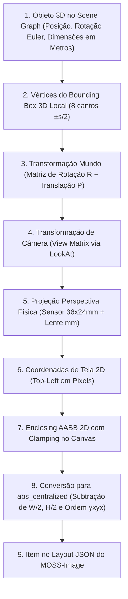

# Pesquisa Técnica: MOSS-Image no ComfyUI Local (`SHOT-32`)

Este documento consolida a pesquisa técnica de arquitetura, parâmetros de amostragem, pipeline no ComfyUI e a formulação matemática para conversão de objetos 3D do **Scene Graph** do Shotlab em coordenadas de **Layout JSON** (`abs_centralized`, formato `yxyx`) para o motor de difusão **MOSS-Image**.

---

## 1. Visão Geral & Contexto no Shotlab

No marco **M3** (Validação Dual-Engine), o Shotlab avalia dois motores generativos complementares:
1. **Qwen Image 2.1**: Motor guiado por imagem de referência (ControlNet / Passes de Depth + RGB Clay).
2. **MOSS-Image** (`MOSS-Image-Base` e `MOSS-Image-SFT`): Motor baseado em Transformers de Difusão (DiT 5B) com suporte nativo a **Layout-to-Image** e renderização precisa de tipografia multilíngue.

### 1.1 O que torna o MOSS-Image único
- **Renderização Tipográfica Nativamente Alinhada**: É capaz de renderizar textos nítidos em inglês, chinês e outras línguas sem deformações ou "letras inventadas", contanto que o texto e as quebras de linha sejam explicitados.
- **Controle Espacial por Layout JSON**: Permite posicionar elementos na cena indicando caixas delimitadoras absolutas (*bounding boxes*) e descrições semânticas individuais, eliminando a necessidade de gerar mapas de profundidade pesados para controle de composição básica.
- **Treinamento Single-Stream com Muon**: Treinado com o otimizador Muon em uma arquitetura DiT de fluxo único de 5B parâmetros.

### 1.2 Instalação Local Verificada
O ambiente local do usuário já possui o ecossistema instalado e configurado em:
- **Repositório do Modelo & Nós**: `/home/rukashi/Documentos/ComfyUI_windows_portable/MOSS-Image`
- **Link Simbólico no ComfyUI**: `/home/rukashi/Documentos/ComfyUI_windows_portable/ComfyUI/custom_nodes/moss-image` $\to$ `../../MOSS-Image/comfyui/moss-image`
- **Pesos Oficiais SFT (BF16, Diffusers Sharded)**: `/home/rukashi/Documentos/ComfyUI_windows_portable/ComfyUI/models/moss-image-sft/transformer/` (`10.16 GB`, sharded em 3 partes)
- **Text Encoder (Qwen3.5-9B INT8 convrot)**: `/home/rukashi/Documentos/ComfyUI_windows_portable/ComfyUI/models/text_encoders/qwen3.5_9b_int8_convrot.safetensors` (`9.1 GB`)
- **VAE Oficial (Flux2 VAE)**: `/home/rukashi/Documentos/ComfyUI_windows_portable/ComfyUI/models/moss-image-sft/vae/` e `models/vae/flux2-vae_small.safetensors` (`238 MB`)
- **Workflows Salvos**: `/home/rukashi/Documentos/ComfyUI_windows_portable/ComfyUI/user/default/workflows/moss-image-sft.json` e `moss-image-sft-layout.json`.

> [!IMPORTANT]
> **Compatibilidade de Pesos**: O plugin nativo do OpenMOSS implementa o `MOSSImageTransformer` com matrizes de projeção linear separadas (`proj.q`, `proj.k`, `proj.v`). Portanto, deve-se utilizar estritamente o checkpoint oficial sharded em BF16 (`OpenMOSS-Team/MOSS-Image-SFT`), **nunca** o checkpoint fundido com quantização `convrot` da Comfy-Org (`moss_image_sft_int8_convrot.safetensors`), o qual falha por incompatibilidade de chaves. O Text Encoder INT8 da Comfy-Org (`qwen3.5_9b_int8_convrot.safetensors`), por outro lado, é 100% compatível e recomendado para economia de memória.

---

## 2. Arquitetura do MOSS-Image (5B DiT) e Custom Nodes no ComfyUI

### 2.1 Especificações do Modelo DiT (`MOSSImageTransformer`)

O núcleo do MOSS-Image é definido em `comfyui/moss-image/model.py`:

| Parâmetro | Valor | Descrição |
| :--- | :--- | :--- |
| **Parâmetros Totais** | $\approx 5.1\text{B}$ | DiT denso de fluxo unificado (imagem + texto) |
| **Dimensão Oculta (`dim`)** | `3072` | Largura dos blocos de atenção |
| **Camadas (`num_layers`)** | `42` | 42 blocos transformer idênticos |
| **Cabeças de Atenção (`num_heads`)** | `24` | Dimensão por cabeça = $3072 / 24 = 128$ |
| **FFN Dimension (`ffn_dim`)** | `8192` | Dimensão intermediária da camada feed-forward |
| **Text Dimension (`text_dim`)** | `4096` | Dimensão das ativações do Qwen3.5-9B |
| **Canais Latentes (`latent_channels`)** | `128` | Flux2 VAE patchificado ($16 \times 2 \times 2 = 128$) |
| **Frequência Temporal (`freq_dim`)** | `256` | Incorporação senoidal de timestep |
| **RoPE Base (`rope_base`)** | `10000.0` | Base de codificação posicional rotacional 4D |

#### Função de Ativação `situ`
O modelo substitui ativações tradicionais como GELU/SwiGLU pela função **situ**:
$$\operatorname{situ}(h, g) = \left(4.0 \cdot \tanh\left(\frac{g}{4.0}\right) \cdot \sigma(g)\right) \cdot \left(25.0 \cdot \tanh\left(\frac{h}{25.0}\right)\right)$$
onde $g$ é o gate linear e $h$ é a projeção up do FFN. Essa função satura gradientes extremos, garantindo estabilidade numérica em precisão FP8/BF16.

#### RoPE 4D Centralizado
As coordenadas espaciais dos patches de imagem e dos tokens de texto são embutidas conjuntamente através de RoPE 4D com os eixos $(r, f, h, w)$. Para a imagem, a grade é expressa centralizada:
$$h_{\text{norm}} = h - \frac{H_{\text{patches}} - 1}{2}, \quad w_{\text{norm}} = w - \frac{W_{\text{patches}} - 1}{2}$$
Essa formulação centralizada na física da atenção correlaciona-se diretamente com o espaço `abs_centralized` exigido no Layout JSON.

#### Text Encoder (Qwen3.5-9B ChatML)
O nó de tokenização formata qualquer prompt de texto encapsulado no formato ChatML com fechamento imediato para a tag de reflexão do assistente:
```text
<|im_start|>user
{prompt}<|im_end|>
<|im_start|>assistant
<think>
```
O modelo lê até um limite máximo de **4096 tokens**, permitindo prompts de Layout JSON ricos com dezenas de elementos e tags de estilo sem corte abrupto.

### 2.2 Nós Registrados no ComfyUI (`comfyui/moss-image/nodes.py`)

1. **`MOSSImageHFLoader`**:
   - Carrega o modelo completo a partir de um diretório Diffusers (`transformer/`, `tokenizer/`, `vae/`).
   - Entradas: `model_path` (string), `weight_dtype` (default/bf16/fp8_e4m3fn), `text_device` (default/cpu).
   - Saídas: `MODEL`, `CLIP`, `VAE`.
2. **`MOSSImageHFDiTLoader`**:
   - Carrega exclusivamente o DiT a partir do diretório Diffusers sharded (`/models/moss-image-sft`).
   - Permite separar o carregamento do transformer dos demais componentes.
3. **`MOSSImageCLIPLoader`**:
   - Carrega o Text Encoder Qwen3.5-9B do diretório padrão `models/text_encoders/`.
   - Oferece o parâmetro `device`: `"cpu"` (mantém o text encoder na memória RAM, poupando $\approx 9\text{ GB}$ de VRAM) ou `"default"` (execução direta na GPU).
4. **`MOSSImageHFVAELoader`** e **`MOSSImageHFTextEncoderLoader`**:
   - Carregadores modulares específicos.
5. **`MOSSImageUNETLoader`**:
   - Carregador para checkpoints legados no diretório `diffusion_models/`.

---

## 3. Parâmetros Obrigatórios de Inferência e Amostragem

Para obter fidelidade visual, ausência de artefatos e perfeita aderência ao layout, o MOSS-Image exige configurações rigorosas:

| Parâmetro | Valor Obrigatório / Recomendado | Justificativa Técnica |
| :--- | :--- | :--- |
| **Resoluções** | Múltiplos estritos de **16** pixels | A arquitetura do VAE Flux2 e o patch de $2\times 2$ latente exigem alinhamento exato de 16 pixels. Resoluções não múltiplas disparam erro de validação. |
| **Contagem de Pixels** | **1.0M, 1.5M ou 2.0M pixels** | Áreas calibradas no pré-treino e SFT. Exemplos: $1024\times 1024$ (1.0M), $1536\times 1024$ (1.5M), $1408\times 1408$ ou $1792\times 1152$ (2.0M). |
| **Inference Steps** | **$\ge 50$ passos** (padrão: 50) | O MOSS-Image-SFT é um modelo base sem destilação de passos (DMD/LCM). Abaixo de 45 passos, a convergência textural e de texto é incompleta. |
| **CFG Scale** | **3.0** (faixa útil: 3.0 a 6.0) | CFG 3.0 é o valor ótimo para prompts descritivos e Layouts JSON. Prompts curtos podem usar CFG até 5.0. Valores acima de 6.0 causam superexposição cromática (*color burning*). |
| **Shift** | **5.0** | Obrigatório para Flow Matching com Latent Flux2. Deve ser aplicado via nó `ModelSamplingSD3`. |
| **Sampler** | **`euler`** | O solucionador Euler de primeira ordem é a referência estável e livre de oscilações para este modelo. |
| **Scheduler** | **`sgm_uniform`** | Garante espaçamento linear e suave no agendamento de ruído sigma do Flow Matching. |
| **SLG (Skip Layer Guidance)** | **Layer 22** (`single_layers: "22"`) | Essencial para nitidez de texto e consistência geométrica. |

### 3.1 SLG (Skip Layer Guidance) em Detalhe

O **Skip Layer Guidance** atua pulando seletivamente camadas intermediárias da rede durante a inferência do ramo incondicional (*negative/unconditional branch*).

- **Nó no ComfyUI**: `SkipLayerGuidanceDiTSimple` (nó nativo do pacote `comfy_extras/nodes_slg.py`).
- **Hook no Modelo**: O `MOSSImageTransformer` implementa o gancho de substituição `blocks_replace[("single_block", layer_index)]`, permitindo que o ComfyUI intercepte qualquer camada individual.
- **Configuração Ótima**:
  - `single_layers`: `"22"` (0-indexado, no intervalo de 0 a 41).
  - `double_layers`: `""` (vazio, pois o MOSS é single-stream).
  - `start_percent`: `0.0`
  - `end_percent`: `1.0`
- **Ordem de Conexão Crítica**:
  ```mermaid
  graph LR
    DIT["MOSSImageHFDiTLoader"] --> SHIFT["ModelSamplingSD3 (shift=5.0)"]
    SHIFT --> SLG["SkipLayerGuidanceDiTSimple (layer=22)"]
    SLG --> KS["KSampler (steps=50, cfg=3.0, euler, sgm_uniform)"]
  ```
  > [!WARNING]
  > O nó `ModelSamplingSD3` **deve sempre preceder** o nó de SLG. Se a ordem for invertida, o cálculo percentual de sigmas do ComfyUI desalinha os limiares de ativação do SLG em relação ao agendamento de fluxo.

### 3.2 Estratégia de Gerenciamento de VRAM (NVIDIA RTX 4080 / 16 GB)
1. **Perfil de Baixo Consumo (Recomendado)**:
   - DiT em `weight_dtype: "default"` (BF16, fidelidade total).
   - CLIP em `device: "cpu"` no nó `MOSSImageCLIPLoader`.
   - **Pico de VRAM**: $\approx 11.8\text{ GB}$ (sobra $\approx 4.2\text{ GB}$ para o SO e o Three.js).
   - Tempo médio de geração ($1024\times 1024$, 50 steps): $\approx 180\text{ s}$.
2. **Perfil de Alta Velocidade**:
   - DiT em `weight_dtype: "default"`.
   - CLIP em `device: "default"` (GPU).
   - **Pico de VRAM**: $\approx 15.0\text{ GB}$ ($\approx 1\text{ GB}$ de margem de segurança).
   - Tempo médio de geração: $\approx 150\text{ s}$.

---

## 4. Especificação do Formato Layout JSON

O MOSS-Image interpreta nativamente prompts estruturados em JSON transmitidos no slot de texto do positivo (`CLIPTextEncode`). O modelo detecta a presença das chaves de layout e direciona as atenções espaciais correspondentes.

### 4.1 Estrutura Canônica do Layout JSON

```json
{
  "summary": {
    "meta": ["advertising photography", "studio shot", "clean background"],
    "canvas": "single",
    "caption": "A high-end studio commercial shot of a luxury cosmetic bottle centered on a black acrylic podium with soft reflections and sharp typography."
  },
  "items": [
    {
      "label": "text",
      "caption": "Minimalist geometric sans-serif title in white capital letters at the top.",
      "text": "SHOTLAB STUDIO",
      "bbox": [-448, -384, -368, 384]
    },
    {
      "label": "object",
      "caption": "A frosted glass cosmetic bottle with a matte black pump dispenser resting on an acrylic pedestal.",
      "bbox": [-160, -128, 288, 128]
    },
    {
      "label": "text",
      "caption": "Refined editorial subtitle in small white lettering below the product.",
      "text": "PRECISION LIGHTING & OPTICS",
      "bbox": [336, -256, 384, 256]
    }
  ],
  "bbox_coord_space": "abs_centralized",
  "bbox_format": "yxyx"
}
```

### 4.2 Dicionário de Campos

| Campo | Tipo | Obrigatoriedade | Descrição |
| :--- | :--- | :--- | :--- |
| `bbox_coord_space` | String | **Obrigatório** | Deve ser estritamente `"abs_centralized"`. |
| `bbox_format` | String | **Obrigatório** | Deve ser estritamente `"yxyx"`. |
| `summary.caption` | String | **Obrigatório** | Descrição global e estilo visual de toda a cena. |
| `summary.meta` | Array[String] | Opcional | Tags de gênero, técnica ou tipo de enquadramento (ex: `["poster", "macro"]`). |
| `summary.canvas` | String | Opcional | `"single"` (padrão), `"multi_panel"` ou `"collage"`. |
| `items` | Array[Objeto] | **Obrigatório** | Lista plana de elementos diagramados no canvas. |
| `items[i].label` | String | **Obrigatório** | Identificador de classe: `"object"`, `"character"` ou `"text"`. |
| `items[i].caption`| String | **Obrigatório** | Descrição detalhada do elemento específico e sua textura/aparência. |
| `items[i].text` | String | **Obrigatório se `label="text"`** | Conteúdo literal da tipografia a ser desenhada, com `\n` explícito para quebras de linha. |
| `items[i].bbox` | Array[Int] | **Obrigatório** | Vetor com 4 inteiros: $[y_{\min}, x_{\min}, y_{\max}, x_{\max}]$. |

### 4.3 Sistema de Coordenadas `abs_centralized`
Diferente de sistemas que utilizam coordenadas normalizadas relativas ($[0.0, 1.0]$), o MOSS-Image adota **pixels absolutos centralizados**:
- **Origem $(0, 0)$**: Localizada no **centro exato** do canvas ($W/2, H/2$).
- **Eixo $X$**: Valores negativos para a esquerda, positivos para a direita (intervalo: $[-W/2, +W/2]$).
- **Eixo $Y$**: Valores negativos para cima, positivos para baixo (intervalo: $[-H/2, +H/2]$).
- **Ordem `yxyx`**: $[y_{\min}, x_{\min}, y_{\max}, x_{\max}]$.
  - $y_{\min} < y_{\max}$
  - $x_{\min} < x_{\max}$

```
(-W/2, -H/2)              (0, -H/2)               (+W/2, -H/2)
      +-----------------------+-----------------------+
      |                       |                       |
      |          Q2           |          Q1           |
      |     (x < 0, y < 0)    |     (x > 0, y < 0)    |
      |                       |                       |
(-W/2, 0) ----------------- (0, 0) ----------------- (+W/2, 0)  --> Eixo X (+)
      |                       |                       |
      |          Q3           |          Q4           |
      |     (x < 0, y > 0)    |     (x > 0, y > 0)    |
      |                       |                       |
      +-----------------------+-----------------------+
(-W/2, +H/2)              (0, +H/2)               (+W/2, +H/2)
                              |
                              V
                          Eixo Y (+)
```

---

## 5. Algoritmo Matemático: Projeção 3D (Scene Graph) $\to$ Layout JSON

Para alimentar o MOSS-Image a partir do Shotlab, o backend projeta a geometria tridimensional do Scene Graph através dos parâmetros ópticos da câmera virtual física.



### 5.1 Definições e Parâmetros de Entrada

1. **Objeto 3D ($j$)**:
   - Posição no mundo: $\mathbf{P} = [P_x, P_y, P_z]^T$ (em metros).
   - Rotação Euler: $[\alpha, \beta, \gamma] = [\text{pitch}, \text{yaw}, \text{roll}]$ (em radianos).
   - Dimensões / Escala: $\mathbf{S} = [S_x, S_y, S_z]^T$ (largura, altura, profundidade em metros).
2. **Câmera Virtual Fotográfica**:
   - Posição da câmera: $\mathbf{C} = [C_x, C_y, C_z]^T$ (em metros).
   - Ponto focal de mira (*Target*): $\mathbf{T} = [T_x, T_y, T_z]^T$ (em metros).
   - Vetor de referência para cima: $\mathbf{U}_{\text{up}} = [0, 1, 0]^T$.
   - Distância focal: $f_{\text{mm}}$ (em milímetros, ex: $85\text{ mm}$).
   - Dimensões do sensor: $W_{\text{sensor}}, H_{\text{sensor}}$ (em milímetros, ex: $36\text{ mm} \times 24\text{ mm}$ para Full Frame 3:2).
   - Resolução da imagem final: $W \times H$ (pixels múltiplos de 16, ex: $1024 \times 1024$ ou $1536 \times 1024$).

---

### 5.2 Passo a Passo da Formulação Matemática

#### Passo 1: Construção dos 8 Vértices Locais
Em coordenadas locais do objeto com centro em $(0,0,0)$, os 8 cantos da caixa delimitadora são dados por:
$$\mathbf{v}_{\text{local}}^{(k)} = \left[ \pm \frac{S_x}{2}, \; \pm \frac{S_y}{2}, \; \pm \frac{S_z}{2} \right]^T \quad \text{para } k \in \{1, \dots, 8\}$$

#### Passo 2: Matriz de Rotação e Transformação de Mundo
A rotação Euler combinada $\mathbf{R} = \mathbf{R}_y(\beta) \mathbf{R}_x(\alpha) \mathbf{R}_z(\gamma)$ é dada por:
$$\mathbf{R} = \begin{bmatrix}
\cos\beta\cos\gamma + \sin\beta\sin\alpha\sin\gamma & -\cos\beta\sin\gamma + \sin\beta\sin\alpha\cos\gamma & \sin\beta\cos\alpha \\
\cos\alpha\sin\gamma & \cos\alpha\cos\gamma & -\sin\alpha \\
-\sin\beta\cos\gamma + \cos\beta\sin\alpha\sin\gamma & \sin\beta\sin\gamma + \cos\beta\sin\alpha\cos\gamma & \cos\beta\cos\alpha
\end{bmatrix}$$

Cada vértice é transformado para coordenadas de mundo:
$$\mathbf{v}_{\text{world}}^{(k)} = \mathbf{R} \cdot \mathbf{v}_{\text{local}}^{(k)} + \mathbf{P}$$

#### Passo 3: Matriz de Visualização da Câmera (View Matrix)
Calcula-se a base ortonormal da câmera:
$$\mathbf{f} = \frac{\mathbf{T} - \mathbf{C}}{\|\mathbf{T} - \mathbf{C}\|_2} \quad (\text{vetor frontal / forward})$$
$$\mathbf{r} = \frac{\mathbf{f} \times \mathbf{U}_{\text{up}}}{\|\mathbf{f} \times \mathbf{U}_{\text{up}}\|_2} \quad (\text{vetor lateral / right})$$
$$\mathbf{u} = \mathbf{r} \times \mathbf{f} \quad (\text{vetor superior verdadeiro / true up})$$

A transformação de mundo para o espaço de câmera $\mathbf{v}_{\text{cam}} = [x_c, y_c, z_c]^T$ segue:
$$\mathbf{v}_{\text{cam}}^{(k)} = \begin{bmatrix}
r_x & r_y & r_z \\
u_x & u_y & u_z \\
-f_x & -f_y & -f_z
\end{bmatrix} (\mathbf{v}_{\text{world}}^{(k)} - \mathbf{C})$$
*(Nota: no padrão Three.js/OpenGL, o eixo óptico da câmera aponta para $-Z$, portanto objetos visíveis possuem $z_c < 0$)*.

Se todos os 8 vértices possuírem $z_c \ge -0.05$, o objeto está totalmente atrás da câmera e deve ser descartado da projeção.

#### Passo 4: Projeção Perspectiva Baseada na Lente Real
Os campos de visão vertical ($\theta_v$) e horizontal ($\theta_h$) da lente física e sensor são:
$$\theta_v = 2 \arctan\left(\frac{H_{\text{sensor}}}{2 f_{\text{mm}}}\right), \quad \theta_h = 2 \arctan\left(\frac{W_{\text{sensor}}}{2 f_{\text{mm}}}\right)$$

As coordenadas normalizadas no plano de projeção (NDC $\in [-1, 1]$) são:
$$x_{\text{ndc}}^{(k)} = \frac{x_c^{(k)}}{-z_c^{(k)} \cdot \tan(\theta_h / 2)}$$
$$y_{\text{ndc}}^{(k)} = \frac{y_c^{(k)}}{-z_c^{(k)} \cdot \tan(\theta_v / 2)}$$

#### Passo 5: Mapeamento para Pixels de Imagem (Top-Left)
Convertendo do espaço NDC $[-1, 1]$ para coordenadas de imagem com origem no canto superior esquerdo $[0, W] \times [0, H]$:
$$x_{\text{pixel}}^{(k)} = \left(\frac{x_{\text{ndc}}^{(k)} + 1}{2}\right) \cdot W$$
$$y_{\text{pixel}}^{(k)} = \left(\frac{1 - y_{\text{ndc}}^{(k)}}{2}\right) \cdot H$$

#### Passo 6: Caixa Delimitadora 2D (AABB 2D) com Clamping
Calculam-se os extremos e aplica-se o clamping aos limites da tela:
$$x_{\text{tl\_min}} = \max\left(0, \min_{k=1..8} x_{\text{pixel}}^{(k)}\right), \quad x_{\text{tl\_max}} = \min\left(W, \max_{k=1..8} x_{\text{pixel}}^{(k)}\right)$$
$$y_{\text{tl\_min}} = \max\left(0, \min_{k=1..8} y_{\text{pixel}}^{(k)}\right), \quad y_{\text{tl\_max}} = \min\left(H, \max_{k=1..8} y_{\text{pixel}}^{(k)}\right)$$

Critério de visibilidade: se $x_{\text{tl\_max}} - x_{\text{tl\_min}} < 16$ ou $y_{\text{tl\_max}} - y_{\text{tl\_min}} < 16$ pixels, o objeto é demasiadamente pequeno ou está fora do enquadramento.

#### Passo 7: Conversão Final para `abs_centralized` no Formato `yxyx`
Conforme especificação do MOSS-Image (`compile_prompt.py`), os limites devem ser arredondados para inteiros com $\lfloor \cdot \rfloor$ nas bordas esquerdas/superiores e $\lceil \cdot \rceil$ nas bordas direitas/inferiores, subtraindo $W/2$ e $H/2$:

$$y_{\min} = \left\lfloor y_{\text{tl\_min}} \right\rfloor - \frac{H}{2}$$
$$x_{\min} = \left\lfloor x_{\text{tl\_min}} \right\rfloor - \frac{W}{2}$$
$$y_{\max} = \left\lceil y_{\text{tl\_max}} \right\rceil - \frac{H}{2}$$
$$x_{\max} = \left\lceil x_{\text{tl\_max}} \right\rceil - \frac{W}{2}$$

O vetor final do objeto para o JSON é:
$$\mathbf{bbox}_{\text{moss}} = [y_{\min}, x_{\min}, y_{\max}, x_{\max}]$$

---

### 5.3 Implementação de Referência em Python

Este módulo pode ser integrado diretamente em `backend/services/moss_layout.py`:

```python
import math
from typing import List, Dict, Any, Optional, Tuple
from models.scene import SceneObjectModel, CameraModel, SceneGraphModel

def project_scene_to_moss_layout(
    scene: SceneGraphModel,
    canvas_width: int = 1024,
    canvas_height: int = 1024,
    global_caption: str = "A professional studio photograph with realistic studio lighting and optical depth of field."
) -> Dict[str, Any]:
    """
    Converte os objetos 3D do SceneGraphModel e a câmera física do Shotlab
    em um Layout JSON compatível com o MOSS-Image (abs_centralized, yxyx).
    """
    assert canvas_width % 16 == 0 and canvas_height % 16 == 0, "Dimensões devem ser múltiplas de 16"

    cam = scene.camera
    # 1. Ângulos de visão da câmera física
    fov_v_rad = 2.0 * math.atan(cam.sensor_height_mm / (2.0 * cam.focal_length_mm))
    fov_h_rad = 2.0 * math.atan(cam.sensor_width_mm / (2.0 * cam.focal_length_mm))
    tan_half_v = math.tan(fov_v_rad / 2.0)
    tan_half_h = math.tan(fov_h_rad / 2.0)

    # 2. Base ortonormal da câmera (LookAt)
    cx, cy, cz = cam.position
    tx, ty, tz = cam.target
    fx, fy, fz = tx - cx, ty - cy, tz - cz
    f_len = math.sqrt(fx * fx + fy * fy + fz * fz) or 1.0
    fx, fy, fz = fx / f_len, fy / f_len, fz / f_len

    # Vetor Up de referência [0, 1, 0]
    rx = fy * 0.0 - fz * 1.0
    ry = fz * 0.0 - fx * 0.0
    rz = fx * 1.0 - fy * 0.0
    r_len = math.sqrt(rx * rx + ry * ry + rz * rz) or 1.0
    rx, ry, rz = rx / r_len, ry / r_len, rz / r_len

    # True Up = Right x Forward
    ux = ry * fz - rz * fy
    uy = rz * fx - rx * fz
    uz = rx * fy - ry * fx

    half_w = canvas_width // 2
    half_h = canvas_height // 2
    items = []

    for obj in scene.objects:
        if not obj.visible or obj.type == 'backdrop':
            continue

        # 3. Vértices da caixa delimitadora local
        sx, sy, sz = obj.scale
        hx, hy, hz = sx / 2.0, sy / 2.0, sz / 2.0
        local_corners = [
            [-hx, -hy, -hz], [hx, -hy, -hz],
            [-hx,  hy, -hz], [hx,  hy, -hz],
            [-hx, -hy,  hz], [hx, -hy,  hz],
            [-hx,  hy,  hz], [hx,  hy,  hz],
        ]

        # 4. Rotação Euler e posição de mundo
        pitch, yaw, roll = obj.rotation
        cp, sp = math.cos(pitch), math.sin(pitch)
        cy_a, sy_a = math.cos(yaw), math.sin(yaw)
        cr, sr = math.cos(roll), math.sin(roll)

        R = [
            [cy_a * cr + sy_a * sp * sr, -cy_a * sr + sy_a * sp * cr, sy_a * cp],
            [cp * sr, cp * cr, -sp],
            [-sy_a * cr + cy_a * sp * sr, sy_a * sr + cy_a * sp * cr, cy_a * cp],
        ]

        px, py, pz = obj.position
        pixel_x_coords = []
        pixel_y_coords = []
        visible_in_front = False

        for lx, ly, lz in local_corners:
            # Posição no mundo
            wx = R[0][0] * lx + R[0][1] * ly + R[0][2] * lz + px
            wy = R[1][0] * lx + R[1][1] * ly + R[1][2] * lz + py
            wz = R[2][0] * lx + R[2][1] * ly + R[2][2] * lz + pz

            # Vetor em relação à câmera
            dx, dy, dz = wx - cx, wy - cy, wz - cz

            # Espaço da câmera
            cam_x = rx * dx + ry * dy + rz * dz
            cam_y = ux * dx + uy * dy + uz * dz
            cam_z = -(fx * dx + fy * dy + fz * dz)  # Espaço OpenGL: -Z para a frente

            if cam_z < -0.05:  # Ponto em frente à lente
                visible_in_front = True
                ndc_x = cam_x / (-cam_z * tan_half_h)
                ndc_y = cam_y / (-cam_z * tan_half_v)

                px_x = ((ndc_x + 1.0) / 2.0) * canvas_width
                px_y = ((1.0 - ndc_y) / 2.0) * canvas_height
                pixel_x_coords.append(px_x)
                pixel_y_coords.append(px_y)

        if not visible_in_front or not pixel_x_coords:
            continue

        # 5. Envelopamento 2D e Clamping no canvas
        raw_x1 = max(0.0, min(pixel_x_coords))
        raw_x2 = min(float(canvas_width), max(pixel_x_coords))
        raw_y1 = max(0.0, min(pixel_y_coords))
        raw_y2 = min(float(canvas_height), max(pixel_y_coords))

        if raw_x2 - raw_x1 < 16 or raw_y2 - raw_y1 < 16:
            continue  # Descarta caixas degeneradas ou imperceptíveis

        # 6. Conversão para abs_centralized [y_min, x_min, y_max, x_max]
        y_min = math.floor(raw_y1) - half_h
        x_min = math.floor(raw_x1) - half_w
        y_max = math.ceil(raw_y2) - half_h
        x_max = math.ceil(raw_x2) - half_w

        items.append({
            "label": "object",
            "caption": f"A realistic {obj.name} with material color {obj.material.color}, roughness {obj.material.roughness:.2f}, studio quality.",
            "bbox": [y_min, x_min, y_max, x_max]
        })

    return {
        "summary": {
            "meta": ["studio photography", "commercial shoot", "clean composition"],
            "canvas": "single",
            "caption": global_caption
        },
        "items": items,
        "bbox_coord_space": "abs_centralized",
        "bbox_format": "yxyx"
    }
```

---

## 6. Exemplo Prático: Cena do Shotlab $\to$ Layout JSON

Suponha uma cena comercial do Shotlab com:
- **Resolução**: $1024 \times 1024$ pixels (centro em $X=512, Y=512$).
- **Câmera**: Lente $85\text{ mm}$, Sensor Full Frame ($36 \times 24\text{ mm}$), Posição $[0.0, 1.3, 2.2]\text{ m}$, Mirando em $[0.0, 0.8, 0.0]\text{ m}$.
- **Objetos 3D**:
  1. `podium`: Mesa/Pedestal central em $[0.0, 0.5, 0.0]\text{ m}$, escala $[0.8, 0.6, 0.8]\text{ m}$.
  2. `perfume_bottle`: Frasco de perfume sobre o pedestal em $[0.0, 0.95, 0.0]\text{ m}$, escala $[0.15, 0.30, 0.15]\text{ m}$.

### Execução da Projeção:
1. Os 8 vértices do frasco de perfume geram coordenadas em pixels de tela:
   - $x \in [440, 584]$ pixels
   - $y \in [336, 680]$ pixels
2. Aplicação de `abs_centralized` ($H=1024, W=1024$, subtraindo $512$):
   - $y_{\min} = 336 - 512 = -176$
   - $x_{\min} = 440 - 512 = -72$
   - $y_{\max} = 680 - 512 = +168$
   - $x_{\max} = 584 - 512 = +72$
   - $\mathbf{bbox} = [-176, -72, 168, 72]$

### JSON Gerado Pronto para o MOSS-Image:
```json
{
  "summary": {
    "meta": ["luxury product photography", "studio lighting", "shallow depth of field"],
    "canvas": "single",
    "caption": "A high-end commercial studio product shot of a luxury glass perfume bottle resting on an illuminated matte black podium, shot with an 85mm portrait lens, dark gradient studio background."
  },
  "items": [
    {
      "label": "object",
      "caption": "A minimal dark matte acrylic podium with soft edges.",
      "bbox": [128, -256, 448, 256]
    },
    {
      "label": "object",
      "caption": "A crystal-clear glass perfume bottle with golden liquid and a machined metal cap.",
      "bbox": [-176, -72, 168, 72]
    },
    {
      "label": "text",
      "caption": "Crisp serif luxury title in elegant gold foil lettering at the upper center.",
      "text": "ÉLIXIR PUR",
      "bbox": [-416, -240, -352, 240]
    }
  ],
  "bbox_coord_space": "abs_centralized",
  "bbox_format": "yxyx"
}
```

---

## 7. Workflow de Referência em Formato API (`workflows/moss-image-layout.json`)

Para a integração programática com o servidor ComfyUI via HTTP/WebSocket, o workflow oficial exportado em formato API JSON deve seguir a seguinte estrutura de nós:

```json
{
  "1": {
    "inputs": {
      "model_path": "/home/rukashi/Documentos/ComfyUI_windows_portable/ComfyUI/models/moss-image-sft",
      "weight_dtype": "default"
    },
    "class_type": "MOSSImageHFDiTLoader",
    "_meta": {
      "title": "MOSS-Image-SFT DiT (BF16)"
    }
  },
  "2": {
    "inputs": {
      "clip_name": "qwen3.5_9b_int8_convrot.safetensors",
      "device": "cpu"
    },
    "class_type": "MOSSImageCLIPLoader",
    "_meta": {
      "title": "Qwen3.5-9B Text Encoder (INT8)"
    }
  },
  "3": {
    "inputs": {
      "vae_name": "flux2-vae_small.safetensors"
    },
    "class_type": "VAEDoader",
    "_meta": {
      "title": "Flux2 VAE"
    }
  },
  "4": {
    "inputs": {
      "shift": 5.0,
      "model": ["1", 0]
    },
    "class_type": "ModelSamplingSD3",
    "_meta": {
      "title": "Flow Matching Shift (5.0)"
    }
  },
  "5": {
    "inputs": {
      "double_layers": "",
      "single_layers": "22",
      "start_percent": 0.0,
      "end_percent": 1.0,
      "model": ["4", 0]
    },
    "class_type": "SkipLayerGuidanceDiTSimple",
    "_meta": {
      "title": "SLG Uncond Skip (Layer 22)"
    }
  },
  "6": {
    "inputs": {
      "text": "{\"summary\":{\"meta\":[\"studio\"],\"canvas\":\"single\",\"caption\":\"...\"},\"items\":[...],\"bbox_coord_space\":\"abs_centralized\",\"bbox_format\":\"yxyx\"}",
      "clip": ["2", 0]
    },
    "class_type": "CLIPTextEncode",
    "_meta": {
      "title": "Layout Positive Prompt"
    }
  },
  "7": {
    "inputs": {
      "text": "nsfw, worst quality, bad anatomy, watermark, jpeg artifact, blurry",
      "clip": ["2", 0]
    },
    "class_type": "CLIPTextEncode",
    "_meta": {
      "title": "Negative Prompt"
    }
  },
  "8": {
    "inputs": {
      "width": 1024,
      "height": 1024,
      "batch_size": 1
    },
    "class_type": "EmptyFlux2LatentImage",
    "_meta": {
      "title": "Empty Flux2 Latent"
    }
  },
  "9": {
    "inputs": {
      "seed": 42,
      "steps": 50,
      "cfg": 3.0,
      "sampler_name": "euler",
      "scheduler": "sgm_uniform",
      "denoise": 1.0,
      "model": ["5", 0],
      "positive": ["6", 0],
      "negative": ["7", 0],
      "latent_image": ["8", 0]
    },
    "class_type": "KSampler",
    "_meta": {
      "title": "KSampler (MOSS Inference)"
    }
  },
  "10": {
    "inputs": {
      "samples": ["9", 0],
      "vae": ["3", 0]
    },
    "class_type": "VAEDecode",
    "_meta": {
      "title": "VAE Decode"
    }
  },
  "11": {
    "inputs": {
      "filename_prefix": "Shotlab_MOSS",
      "images": ["10", 0]
    },
    "class_type": "SaveImage",
    "_meta": {
      "title": "Save Rendered Image"
    }
  }
}
```

---

## 8. Comparativo de Motores: MOSS-Image vs Qwen Image 2.1

| Dimensão Técnica | MOSS-Image-SFT | Qwen Image 2.1 | Recomendação para o Shotlab |
| :--- | :--- | :--- | :--- |
| **Arquitetura** | DiT 5B (Single-Stream) | MM-DiT / Diffusion Unet | MOSS-Image é mais enxuto em peso de parâmetros DiT. |
| **Controle Espacial** | **Layout JSON nativo** (`abs_centralized`) | **Mapas de Profundidade (Depth Pass)** / Imagem de Referência | Para campanhas com tipografia e posicionamento geométrico simples, o Layout JSON do MOSS é imediato e leve. Para formas orgânicas complexas que requerem contato perfeito de silhueta, o Qwen com Depth é superior. |
| **Renderização de Texto** | **Excepcional** (qualidade gráfica editorial e vetorial) | Moderada a boa | MOSS-Image é o motor ideal sempre que a cena tiver rótulos de produtos, pôsteres ou tipografia. |
| **Consumo de VRAM** | $\approx 11.8\text{ GB}$ (CLIP na CPU) / $\approx 15.0\text{ GB}$ (CLIP na GPU) | $\approx 12.5\text{ GB}$ – $14.0\text{ GB}$ | Ambos rodam com folga na RTX 4080 (16 GB) com offload de text encoder quando necessário. |
| **Tempo de Inferência** | $\approx 150\text{ s}$ – $180\text{ s}$ (50 steps) | $\approx 40\text{ s}$ – $70\text{ s}$ (20-30 steps) | Qwen é significativamente mais rápido para iterações interativas de rascunho; MOSS é indicado para render final com layout e texto. |

---

## 9. Próximos Passos de Integração no Backlog

1. **`SHOT-19` (`[M3.1b]` Suporte Dual-Engine: Qwen Image 2.1 vs MOSS-Image)**:
   - Implementar o gerador de prompt `moss_layout.py` no backend FastAPI (`/v1/render/moss`).
   - Salvar o arquivo de workflow `workflows/moss-image-layout.json` no repositório Shotlab.
   - Adicionar o seletor de motor no modal de renderização (`RenderModal.tsx`) do frontend React: `Engine: Qwen Image 2.1 (Depth Guided)` vs `MOSS-Image (Layout JSON Guided)`.
2. **`SHOT-20` (`[M3.1c]` Comparador de Resultados)**:
   - Executar renderizações idênticas a partir do mesmo Scene Graph e comparar a aderência geométrica usando o Curtain Slider.
