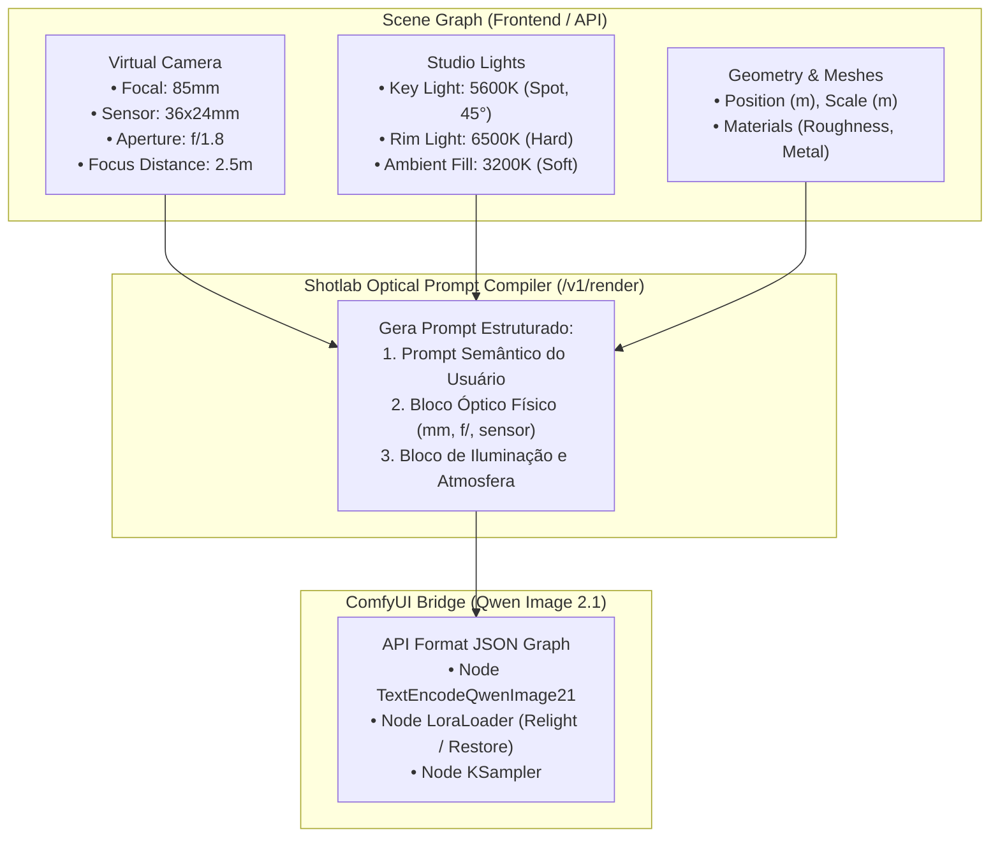
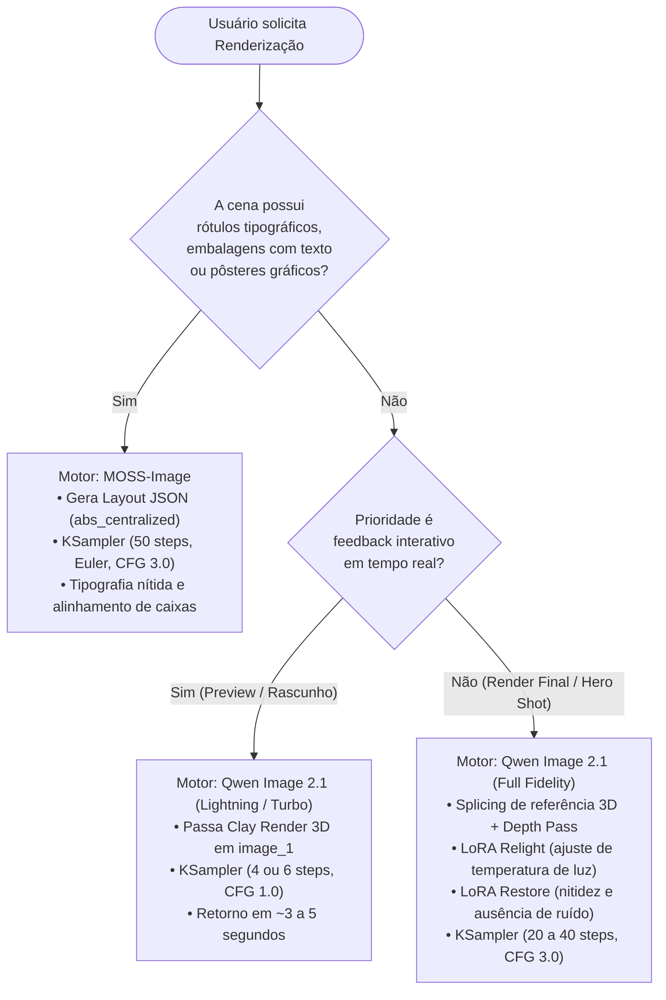

# Pesquisa Técnica: Qwen Image 2.1 no ComfyUI Local (`SHOT-31`)

Este documento consolida a pesquisa técnica de arquitetura, pesos instalados, funcionamento interno dos nós de condicionamento, amostragem e estrutura do grafo API JSON para integração do motor **Qwen Image 2.1** ao pipeline generativo do **Shotlab**.

---

## 1. Visão Geral & Contexto no Shotlab

No marco **M3** (Validação Dual-Engine), o Shotlab implementa suporte a dois motores generativos complementares:
1. **Qwen Image 2.1**: Motor generativo e de edição baseado em Diffusion Transformer multimodal (MM-DiT) com representação latente de alta dimensionalidade (64 canais, $16\times$ downscale), amostragem acelerada (LoRAs Lightning e Turbo de 4 a 6 passos) e splicing direto de referências espaciais e ópticas 3D.
2. **MOSS-Image** (pesquisado na `SHOT-32`): Motor DiT 5B focado em **Layout-to-Image** vetorial e renderização tipográfica multilíngue.

### 1.1 Papel Estratégico do Qwen Image 2.1 no Shotlab
O Qwen Image 2.1 atua como o **motor principal de fotorealismo, transferência de iluminação (Relight) e renderização óptica de cena** no Shotlab:
- **Alinhamento Óptico Direto**: Consome a imagem 3D (Clay Render / RGB Pass) gerada no Three.js do Shotlab e metadados físicos de câmera (distância focal em `mm`, abertura de diafragma `f/`, plano focal em `m` e dimensões de sensor Full Frame `36x24mm`).
- **Splicing de Latentes de Referência (`reference_latents`)**: Ao invés de depender exclusivamente de ControlNets externos que competem por atenção no modelo de difusão, o Qwen Image 2.1 insere as referências visuais diretamente na sequência de atenção do transformer, com coordenadas de posição rotacional 3D (3D-RoPE) vinculadas espacialmente ao canvas alvo.
- **Relighting e Modificação de Ângulo por LoRAs Nativos**: Suporta LoRAs dedicados (`Qwen-Edit-Relight`, `Qwen-Edit-2509-Multiple-angles`) que alteram a temperatura de cor, ângulo de iluminação e ponto de vista da câmera a partir de instruções em linguagem natural ou telemetria 3D.
- **Iteração Ultrarrápida para Pair Programming / Visualização**: Com os adaptadores de destilação de fluxo (`Qwen-Image-Lightning` de 4 passos e `Qwen-Image-2.1-viggle-turbo` de 6 passos), o tempo de renderização cai para **$\approx 3$ a $8$ segundos** em uma GPU NVIDIA RTX 4080 (16 GB), viabilizando feedback visual em tempo quase real.

---

## 2. Inventário Exato dos Pesos Instalados no Ambiente Local

A instalação inspecionada localmente em `/home/rukashi/Documentos/ComfyUI_windows_portable/ComfyUI` contém um ecossistema completo de pesos de primeira e segunda geração da família Qwen-Image:

```
ComfyUI/
├── models/
│   ├── diffusion_models/
│   │   ├── qwen_image_2.1_int8_convrot.safetensors    (6.8 GB)  <-- Principal DiT 2.1
│   │   └── qwen_image_edit_2509_fp8_e4m3fn.safetensors (20 GB)   <-- Legado Qwen Edit 1.0
│   ├── unet/
│   │   ├── Qwen_Image_Distill-Q4_K_S.gguf              (12 GB)   <-- Quantização GGUF
│   │   └── Qwen_Image_Edit-Q4_K_S.gguf                 (12 GB)   <-- Quantização GGUF
│   ├── text_encoders/
│   │   ├── qwen3.5_9b_qwen_image_2.1_pe_i2i.int8_convrot.safetensors (8.9 GB) <-- PE I2I / Edit
│   │   ├── qwen3.5_9b_qwen_image_2.1_pe_t2i.int8_convrot.safetensors (8.9 GB) <-- PE T2I
│   │   ├── qwen3.5_9b_int8_convrot.safetensors         (9.1 GB)  <-- Base LLM INT8
│   │   ├── qwen3vl_8b_int8_convrot.safetensors         (8.8 GB)  <-- Vision-Language 8B
│   │   └── qwen_2.5_vl_7b_fp8_scaled.safetensors       (8.8 GB)  <-- Vision-Language 7B
│   ├── vae/
│   │   ├── qwen_image_2.1_vae_bf16.safetensors         (645 MB)  <-- VAE 64-canais 2.1
│   │   └── qwen_image_vae.safetensors                  (243 MB)  <-- VAE legado 1.0
│   └── loras/
│       ├── Qwen-Image-Lightning-4steps-V1.0.safetensors             (1.6 GB) <-- 4-step DiT
│       ├── Qwen-Image-Edit-2509-Lightning-4steps-V1.0-bf16.safetensors (811 MB) <-- 4-step Edit
│       ├── Qwen-Image-2.1-viggle-turbo-v0.2.1-6step-lora-r256.safetensors (1.3 GB) <-- Turbo r256
│       ├── Qwen-Image-2.1-viggle-turbo-v0.3-6step-lora-r128.safetensors   (649 MB) <-- Turbo r128
│       ├── Qwen-Edit-Relight.safetensors                            (226 MB) <-- Relighting
│       ├── Qwen-Edit-2509-Multiple-angles.safetensors               (226 MB) <-- Ângulos de Câmera
│       ├── qwen-image-2.1-restore.safetensors                       (153 MB) <-- Restauração de Detalhes
│       └── next-scene_lora-v2-3000.safetensors                      (282 MB) <-- Próxima Tomada
```

### 2.1 Mapeamento Detalhado e Funções Específicas

| Categoria | Arquivo | Tamanho | Função no Pipeline do Shotlab |
| :--- | :--- | :--- | :--- |
| **Diffusion Model** | `qwen_image_2.1_int8_convrot.safetensors` | $6.8\text{ GB}$ | Transformer principal de difusão (MM-DiT) do Qwen Image 2.1 com quantização INT8 convrot. Executa a amostragem reversa no espaço latente de 64 canais. |
| **Diffusion Model (Legado)** | `qwen_image_edit_2509_fp8_e4m3fn.safetensors` | $20\text{ GB}$ | Checkpoint FP8 E4M3FN da versão anterior (Qwen-Image Edit 2509). Útil para testes de compatibilidade regressiva. |
| **Text Encoder (I2I / Edit)** | `qwen3.5_9b_qwen_image_2.1_pe_i2i.int8_convrot.safetensors` | $8.9\text{ GB}$ | Text Encoder com Prompt Enhancement (PE) afinado para tarefas de edição e Image-to-Image guiadas por referências visuais e instruções condicionais. |
| **Text Encoder (T2I)** | `qwen3.5_9b_qwen_image_2.1_pe_t2i.int8_convrot.safetensors` | $8.9\text{ GB}$ | Text Encoder com PE otimizado para síntese Text-to-Image pura a partir de descrições ricas de cenas e atributos estilísticos. |
| **Text Encoder (Base VL)** | `qwen_2.5_vl_7b_fp8_scaled.safetensors` | $8.8\text{ GB}$ | Text/Vision Encoder padrão usado nos workflows clássicos de Qwen 2509 e Qwen Edit 1.0. |
| **VAE Nativo 2.1** | `qwen_image_2.1_vae_bf16.safetensors` | $645\text{ MB}$ | Autoencoder variacional oficial com **64 canais latentes** e razão de downscale de **$16\times$** (`spacial_downscale_ratio: 16`). **Obrigatório para o Qwen Image 2.1**. |
| **VAE Legado 1.0** | `qwen_image_vae.safetensors` | $243\text{ MB}$ | VAE de 16 canais da geração 1.0/2509. Incompatível com o DiT 2.1 (provoca erro de dimensão na entrada de canais). |
| **LoRA Turbo (6-Step)** | `Qwen-Image-2.1-viggle-turbo-v0.3-6step-lora-r128.safetensors` | $649\text{ MB}$ | Destilação rápida para 6 passos em rank 128 (`target_modules: ['to_q', 'to_out.0', 'img_mlp.proj', 'img_mlp.out', 'to_v', 'timestep_embedder.linear_1', 'timestep_embedder.linear_2', 'modulation.1', 'to_k', 'img_mlp.gate_layer']`). |
| **LoRA Lightning (4-Step)** | `Qwen-Image-Lightning-4steps-V1.0.safetensors` | $1.6\text{ GB}$ | LoRA de destilação de 4 passos (`lightx2v`). Proporciona síntese ultrarrápida com CFG 1.0. |
| **LoRA Relight** | `Qwen-Edit-Relight.safetensors` | $226\text{ MB}$ | LoRA desenvolvido por `Daniel8152/relight-1` via Modelscope. Altera a iluminação da imagem de referência de acordo com prompts descritivos (ex.: midday sun, sunset golden hour, dramatic studio rim light). |
| **LoRA Multi-Angle** | `Qwen-Edit-2509-Multiple-angles.safetensors` | $226\text{ MB}$ | LoRA de variação de câmera (`maomaod666/qwen-JTZH`). Permite rotacionar ou deslocar o ângulo aparente do sujeito (ex.: "rotate camera 45 degrees left"). |
| **LoRA Restore** | `qwen-image-2.1-restore.safetensors` | $153\text{ MB}$ | LoRA oficial (`qwen21_restore_v2`) para remoção de ruído e artefatos de compressão, recuperando detalhes nítidos de textura sem desviar da composição original. |

---

## 3. Arquitetura do Modelo DiT e Latent Space do Qwen Image 2.1

### 3.1 Especificações do `QwenImage21Transformer2DModel`
O modelo do Qwen Image 2.1 (implementado em `comfy/ldm/qwen_image21/model.py`) opera sob a arquitetura de difusão de fluxo (Flow Matching):

- **Canais Latentes de Entrada/Saída (`in_channels`, `out_channels`)**: `64`
- **Dimensão Oculta Interna (`inner_dim`)**: $32 \text{ heads} \times 128 \text{ head\_dim} = 4096$
- **Camadas Transformer (`num_layers`)**: `32`
- **Dimensão de Contexto de Texto (`context_in_dim`)**: `4096`
- **Feed-Forward SwiGLU (`mlp_ratio=3`)**: Dimensão oculta intermediária de $3 \times 4096 = 12288$, implementada com fusão de projeções lineares (`gate_up`).
- **3D-RoPE (`axes_dims_rope=(16, 56, 56)`)**: Três eixos de rotação:
  - Eixo temporal / sequência de tokens: $16$ dimensões.
  - Eixos espaciais verticais ($H$) e horizontais ($W$): $56 + 56 = 112$ dimensões ($16 + 56 + 56 = 128$, cobrindo exatamente o `head_dim`).

### 3.2 O Espaço Latente de 64 Canais (`latent_formats.QwenImage21`)
Diferente de modelos convencionais baseados em VAEs SD1.5/SDXL ($8\times$ downscale, 4 canais) ou Flux ($8\times$ downscale, 16 canais), o Qwen Image 2.1 introduz uma representação latente profunda com compressão espacial de $16\times$:

$$\text{Shape Latente} = \left[B, 64, \frac{H_{\text{pixels}}}{16}, \frac{W_{\text{pixels}}}{16}\right]$$

Para uma resolução de $1024 \times 1024$:
$$\text{Dimensões Latentes} = [1, 64, 64, 64]$$

Essa alta capacidade de canais ($64$) permite armazenar geometria tridimensional, cores locais e detalhes de alta frequência diretamente no espaço latente sem perdas drásticas de descompressão, tornando o modelo resistente a artefatos de costura ou aberrações de textura.

---

## 4. Análise dos Nós no ComfyUI (`comfy_extras/nodes_qwen.py`)

O arquivo `/home/rukashi/Documentos/ComfyUI_windows_portable/ComfyUI/comfy_extras/nodes_qwen.py` define os nós de condicionamento que alimentam o transformer. A análise do código fonte revela distinções cruciais de funcionamento:

### 4.1 Nó `TextEncodeQwenImage21` (O Nó Canônico para o Shotlab)

```python
class TextEncodeQwenImage21(io.ComfyNode):
    # Inputs: clip, prompt, negative_prompt, vae (opcional), resolution (default 1024),
    #         images: Autogrow (image_1 ... image_16)
    # Outputs: positive (Conditioning), negative (Conditioning), latent (Latent)
```

#### Mecanismo Interno:
1. **Redimensionamento Inteligente com Lanczos**:
   As imagens de referência (`image_1`, `image_2`, ...) são redimensionadas para manter o aspect ratio original com resolução aproximada de `resolution` $\times$ `resolution`, alinhadas estritamente a múltiplos de **$32$** pixels:
   $$\text{ratio} = \frac{W}{H}, \quad W_{\text{new}} = \operatorname{round}\left(\frac{\sqrt{\text{res}^2 \cdot \text{ratio}}}{32}\right) \cdot 32, \quad H_{\text{new}} = \operatorname{round}\left(\frac{\sqrt{\text{res}^2 / \text{ratio}}}{32}\right) \cdot 32$$
   O algoritmo utiliza o filtro de alta fidelidade `"lanczos"`, preservando bordas finas e detalhes de linhas do blockout 3D.
2. **Tratamento de Canal Alfa (Transparência)**:
   Se a imagem renderizada do Three.js contiver canal alfa (fundo transparente):
   ```python
   rgb = rgb * s[:, :, :, 3:] + (1.0 - s[:, :, :, 3:])  # sobreposição sobre fundo branco para a vision tower
   ```
   A vision tower do text encoder analisa o objeto sobreposto em fundo branco neutro, enquanto o codificador do VAE preserva todos os canais para compressão geométrica exata.
3. **Splicing de `reference_latents` e `image_slots`**:
   - Se o `vae` for conectado ao nó, cada imagem de referência é codificada em um tensor latente de 64 canais: `ref_latents.append(vae.encode(s))`.
   - O tokenizer remove os tokens de visão da saída textual do LLM e grava os índices exatos de inserção (`image_slots`).
   - No DiT (`QwenImage21Transformer2DModel.build_sequence`), os latentes de referência são **intercalados diretamente entre os tokens de texto**, e o ruído da imagem alvo $x$ é posicionado no final da sequência.
   - Os tokens de referência e texto recebem modulação de timestep com $t = 0$ (condicionamento invariante no tempo), enquanto apenas o bloco do canvas alvo modula com o timestep dinâmico $t \in [0, 1]$.
4. **Geração Automática do Latente Inicial**:
   O nó calcula a dimensão da primeira imagem de referência e instancia diretamente um tensor de latente vazio:
   ```python
   latent = torch.zeros([1, 64, latent_h // 16, latent_w // 16], device=intermediate_device)
   ```
   Isso elimina a necessidade de um nó `EmptyLatentImage` manual e garante correspondência geométrica pixel-a-pixel entre a referência 3D e o canvas de saída.

### 4.2 Nós Legados: `TextEncodeQwenImageEdit` e `TextEncodeQwenImageEditPlus`

1. **`TextEncodeQwenImageEdit`**:
   - Projetado para o modelo Qwen-Image Edit 1.0 (2509).
   - Aceita apenas uma única imagem de entrada.
   - Força o escalonamento para $1024 \times 1024$ usando interpolação `"area"` (mais borrada que Lanczos).
   - Retorna apenas a saída positiva de condicionamento (não emite o latente vazio nem a saída negativa em um único nó).
2. **`TextEncodeQwenImageEditPlus`**:
   - Projetado para edição multi-imagem em Qwen 2509/2511 com até 3 imagens (`image1`, `image2`, `image3`).
   - Emprega um template rígido de sistema no ChatML:
     ```text
     <|im_start|>system
     Describe the key features of the input image (color, shape, size, texture, objects, background), then explain how the user's text instruction should alter or modify the image. Generate a new image that meets the user's requirements while maintaining consistency with the original input where appropriate.<|im_end|>
     <|im_start|>user
     Picture 1: <|vision_start|><|image_pad|><|vision_end|>{prompt}<|im_end|>
     <|im_start|>assistant
     ```
   - Reduz agressivamente a entrada de visão para $384 \times 384$ pixels para o modelo de linguagem, enquanto codifica $1024 \times 1024$ no VAE.

> [!IMPORTANT]
> **Diretriz de Implementação para o Shotlab**: O Shotlab deve utilizar **estritamente o nó `TextEncodeQwenImage21`**. Ele é o único nó nativo compatível com a arquitetura de 64 canais, permite passar múltiplos passes da cena 3D (ex.: Clay Render em `image_1`, Depth Map em `image_2`, Normal Map em `image_3`) e emite a tupla completa (`positive`, `negative`, `latent`) sincronizada.

### 4.3 Otimização de Performance: `QwenImage21Cache`
O nó `QwenImage21Cache` aproveita uma propriedade matemática única do Qwen Image 2.1: como os tokens de texto e os latentes das imagens de referência modulam com $t = 0$, suas matrizes de Key ($K$) e Value ($V$) no transformer são **constantes em todos os passos da amostragem**.

```python
class QwenImage21Cache(io.ComfyNode):
    # Inputs: model, device ("auto", "gpu", "cpu", "off"), dtype ("default", "int8", "int4")
```
- **Modo `device="auto"`**: Armazena as chaves e valores do prefixo na VRAM restante; caso a VRAM seja inferior a $4\times$ o tamanho do cache, descarrega para a memória RAM (CPU) de forma pré-buscada assincronamente (*prefetching*).
- **Quantização `dtype="int8"`**: Reduz o consumo de memória do cache pela metade sem perda perceptível de coerência visual.
- **Ganho no Shotlab**: Reduz o tempo de inferência por passo em até **$35\%$** em amostragens com 20 a 50 passos.

---

## 5. Parâmetros Ideais de Inferência e Amostragem

A estabilidade e fidelidade da geração dependem da correta calibração do agendador e dos hiperparâmetros de ruído:

| Modo de Geração | Sampler | Scheduler | Passos | CFG Scale | Denoise | LoRAs Ativos | Tempo Estimado (RTX 4080) |
| :--- | :--- | :--- | :--- | :--- | :--- | :--- | :--- |
| **Ultra-Fast (Draft 3D)** | `euler` | `simple` | **4** | **1.0** | `1.0` (T2I) / `0.70` (I2I) | `Qwen-Image-Lightning-4steps-V1.0` | $\approx 2.8\text{ s}$ |
| **Turbo Distill (Viggle)** | `euler` | `simple` | **6** | **1.0** a **1.5** | `1.0` / `0.75` | `Qwen-Image-2.1-viggle-turbo-v0.3` | $\approx 4.2\text{ s}$ |
| **Estúdio Balanceado (Padrão Shotlab)** | `euler` | `simple` ou `normal` | **20** | **2.5** a **3.5** | `1.0` / `0.65` | Nenhum (ou `Restore` / `Relight`) | $\approx 18\text{ s}$ |
| **High-End Editorial (Hero Shot)** | `euler` | `normal` | **40** – **50** | **4.0** | `1.0` / `0.60` | `qwen-image-2.1-restore` (peso `0.7`) | $\approx 45\text{ s}$ |

### 5.1 Regras de Denoise Strength para Preservação do Blockout 3D
Quando o usuário cria uma composição de objetos primitivos ou modelos 3D no Shotlab, a aderência à geometria depende de como a imagem 3D é injetada:

1. **Injeção como `reference_latents` (Recomendado para Render Criativo)**:
   - A imagem RGB 3D é enviada para o slot `image_1` do nó `TextEncodeQwenImage21`.
   - O `latent` de saída do nó alimenta a entrada `latent_image` do `KSampler`.
   - O parâmetro `denoise` no KSampler é mantido em **`1.0`**.
   - **Comportamento**: O modelo reconstrói a cena a partir do ruído total, mas condicionado estruturalmente pelos latentes de referência nos `image_slots`. A liberdade criativa de iluminação e materiais é máxima, respeitando o posicionamento espacial relativo.
2. **Injeção via `VAEEncode` Tradicional (Denoise Parcial I2I)**:
   - O render 3D passa por `VAEEncode` com o `qwen_image_2.1_vae_bf16.safetensors` e alimenta o `latent_image`.
   - O parâmetro `denoise` é ajustado entre **`0.55` e `0.70`**.
   - **Comportamento**: A silhueta, cores de base e contraste do blockout são preservados rigidamente. Valores acima de $0.75$ tendem a ignorar detalhes geométricos secundários; valores abaixo de $0.50$ produzem apenas variações sutis de textura.

---

## 6. Tradução Óptica do Scene Graph do Shotlab em Prompts

O Shotlab adota o princípio de **Física e Medidas Reais** (`AGENTS.md`). Para que o Qwen Image 2.1 sintetize características fotográficas fiéis aos parâmetros ajustados pelo usuário na viewport 3D, o backend do Shotlab constrói o prompt óptico estruturado:

### 6.1 Mapeamento de Parâmetros de Câmera e Luz



### 6.2 Template Padronizado de Prompt Óptico do Shotlab

O compilador de prompt formata a instrução textual em três camadas complementares:

```text
[DESCRIÇÃO DA CENA E SUJEITO DO USUÁRIO],
shot on high-end cinema camera, 35mm full-frame sensor (36x24mm), {focal_length_mm}mm telephoto/wide lens, crisp optical sharpness.
Aperture set to f/{f_stop}, creating natural shallow depth of field, delicate circular bokeh in out-of-focus background elements.
Critical focus locked at {focus_distance_m} meters on foreground subject, subtle optical falloff.
Lighting schema: {lighting_description}, physically accurate caustic reflections and soft contact shadows.
Master shot, clean studio environment, neutral color science, 8k resolution textures, no AI slop, no plastic skin.
```

#### Exemplo Compilado para Cena de Retrato Comercial:
```text
A close-up studio shot of a ceramic perfume bottle placed on a polished dark walnut base with delicate water droplets,
shot on high-end cinema camera, 35mm full-frame sensor (36x24mm), 85mm prime lens, crisp optical sharpness.
Aperture set to f/1.8, creating natural shallow depth of field, delicate circular bokeh in out-of-focus background elements.
Critical focus locked at 1.8 meters on the brass atomizer nozzle, subtle optical falloff.
Lighting schema: three-point studio lighting with a 5600K daylight key light at 45 degrees, soft 3200K warm fill, and a crisp rim backlight accentuating the glass edges.
Master shot, clean studio environment, neutral color science, 8k resolution textures, no AI slop, no plastic skin.
```

---

## 7. Estrutura do Grafo API JSON do ComfyUI para o Shotlab

A seguir apresenta-se o grafo completo em formato de API JSON do ComfyUI (`workflows/qwen21_shotlab_api.json`) configurado para receber o render 3D da cena do Shotlab via nó `LoadImage`, aplicar o LoRA Lightning de 4 passos + LoRA Relight, e amostrar com o nó `TextEncodeQwenImage21`:

```json
{
  "1": {
    "inputs": {
      "unet_name": "qwen_image_2.1_int8_convrot.safetensors"
    },
    "class_type": "UNETLoader",
    "_meta": {
      "title": "Load Qwen 2.1 DiT (INT8)"
    }
  },
  "2": {
    "inputs": {
      "clip_name": "qwen3.5_9b_qwen_image_2.1_pe_i2i.int8_convrot.safetensors",
      "type": "qwen_image"
    },
    "class_type": "CLIPLoader",
    "_meta": {
      "title": "Load Qwen3.5 9B PE (I2I Text Encoder)"
    }
  },
  "3": {
    "inputs": {
      "vae_name": "qwen_image_2.1_vae_bf16.safetensors"
    },
    "class_type": "VAELoader",
    "_meta": {
      "title": "Load Qwen 2.1 VAE (64 Channels)"
    }
  },
  "4": {
    "inputs": {
      "lora_name": "Qwen-Image-Lightning-4steps-V1.0.safetensors",
      "strength_model": 1.0,
      "model": ["1", 0]
    },
    "class_type": "LoraLoaderModelOnly",
    "_meta": {
      "title": "LoRA Lightning (4-Steps Distill)"
    }
  },
  "5": {
    "inputs": {
      "lora_name": "Qwen-Edit-Relight.safetensors",
      "strength_model": 0.8,
      "model": ["4", 0]
    },
    "class_type": "LoraLoaderModelOnly",
    "_meta": {
      "title": "LoRA Studio Relight"
    }
  },
  "6": {
    "inputs": {
      "image": "shotlab_input_pass_3d.png"
    },
    "class_type": "LoadImage",
    "_meta": {
      "title": "Shotlab 3D Pass (Clay or RGB Render)"
    }
  },
  "7": {
    "inputs": {
      "prompt": "Commercial product photography of a modern cosmetic bottle on a granite pedestal, shot on 85mm lens at f/1.8, focus distance 2.0m, studio lighting with rim highlights, ultra-sharp textures, neutral color palette",
      "negative_prompt": "blurry, out of focus, deformed geometry, lowres, cartoon, plastic skin, oversaturated, chromatic aberration, ai slop, watermark",
      "resolution": 1024,
      "clip": ["2", 0],
      "vae": ["3", 0],
      "image_1": ["6", 0]
    },
    "class_type": "TextEncodeQwenImage21",
    "_meta": {
      "title": "Text & Reference Encode (Qwen Image 2.1)"
    }
  },
  "8": {
    "inputs": {
      "seed": 42,
      "steps": 4,
      "cfg": 1.0,
      "sampler_name": "euler",
      "scheduler": "simple",
      "denoise": 1.0,
      "model": ["5", 0],
      "positive": ["7", 0],
      "negative": ["7", 1],
      "latent_image": ["7", 2]
    },
    "class_type": "KSampler",
    "_meta": {
      "title": "KSampler (4-Step Fast Preview)"
    }
  },
  "9": {
    "inputs": {
      "samples": ["8", 0],
      "vae": ["3", 0]
    },
    "class_type": "VAEDecode",
    "_meta": {
      "title": "VAE Decode (64 Channels)"
    }
  },
  "10": {
    "inputs": {
      "filename_prefix": "Shotlab_Qwen21_Render",
      "images": ["9", 0]
    },
    "class_type": "SaveImage",
    "_meta": {
      "title": "Save Rendered Frame"
    }
  }
}
```

---

## 8. Análise Comparativa: Qwen Image 2.1 vs MOSS-Image no Shotlab

| Dimensão Técnica | Qwen Image 2.1 | MOSS-Image (Base / SFT) | Papel Definido no Shotlab |
| :--- | :--- | :--- | :--- |
| **Arquitetura Principal** | MM-DiT multimodal (32 camadas, 4096 dim) com latentes embutidos | DiT unificado de fluxo único 5B (42 camadas, 3072 dim) com ativação `situ` | **Complementares**. Qwen foca em renderização e iluminação; MOSS em diagramação e texto. |
| **Representação Latente** | **64 canais**, $16\times$ downscale (`qwen_image_2.1_vae`) | **128 canais** ($16 \times 2 \times 2$), $16\times$ downscale (`flux2-vae`) | Ambos usam compressão moderna de alta dimensionalidade. |
| **Método de Controle 3D** | **Splicing de `reference_latents`** + mapas de profundidade / passes RGB do Three.js | **Layout JSON textual** (`abs_centralized`, formato `yxyx`) derivado do Scene Graph | **Qwen** para contato geométrico complexo e relevo; **MOSS** para disposição de elementos em caixas 2D. |
| **Controle de Iluminação** | **LoRA Relight dedicado** (`Qwen-Edit-Relight`), alterando direção e temperatura da luz | Parâmetros descritivos em texto no `summary.caption` do JSON | **Qwen** oferece controle granular de iluminação física e sombras de contato. |
| **Tipografia & Textos** | Moderada a boa (renderiza títulos simples e palavras isoladas) | **Excepcional** (qualidade gráfica editorial e vetorial em inglês/chinês) | **MOSS** é a escolha obrigatória sempre que houver rótulos, texto no produto ou cartazes. |
| **Passos de Inferência** | **4 passos** (Lightning) ou **6 passos** (Turbo) | **$\ge 50$ passos** (obrigatório, sem destilação) | **Qwen é $10\times$ a $15\times$ mais rápido** em visualizações interativas. |
| **Consumo de VRAM** | $\approx 10.5\text{ GB}$ – $12.5\text{ GB}$ (DiT INT8 + PE INT8) | $\approx 11.8\text{ GB}$ (CLIP CPU) / $\approx 15.0\text{ GB}$ (CLIP GPU) | Ambos executam com segurança na GPU do usuário (NVIDIA RTX 4080, 16 GB). |
| **Custo de Mudança de Câmera** | Suporta LoRA `Multiple-angles` e variações ópticas de prompt | Requer recálculo completo do Layout JSON no Scene Graph | **Qwen** é ideal para orbitar a câmera ou testar lentes alternativas rapidamente. |

### 8.1 Matriz de Decisão no Shotlab



---

## 9. Próximos Passos de Integração no Backlog

1. **`SHOT-19` (`[M3.1b]` Suporte Dual-Engine: Qwen Image 2.1 vs MOSS-Image)**:
   - Implementar o compilador de workflow `qwen_workflow.py` no backend FastAPI em `backend/app/services/render/qwen.py`.
   - Salvar o template canônico em `workflows/qwen-image-2.1-api.json`.
   - Adicionar o seletor no `RenderModal.tsx` do frontend com modos:
     - `Qwen 2.1 (Lightning 4-Steps - Preview)`
     - `Qwen 2.1 (Studio Fidelity - 20 Steps)`
     - `MOSS-Image (Layout JSON - Typography)`
2. **`SHOT-33` (`[M3.0b]` Skill Global de Orquestração do ComfyUI)**:
   - Configurar a skill global para permitir que o agente valide, execute e inspecione jobs de geração no ComfyUI local via chamadas REST (`/prompt`, `/history`, `/view`).
3. **`SHOT-20` (`[M3.1c]` Comparador de Resultados)**:
   - Renderizar o mesmo Scene Graph pelos dois motores e comparar a fidelidade geométrica através do componente Curtain Slider.
